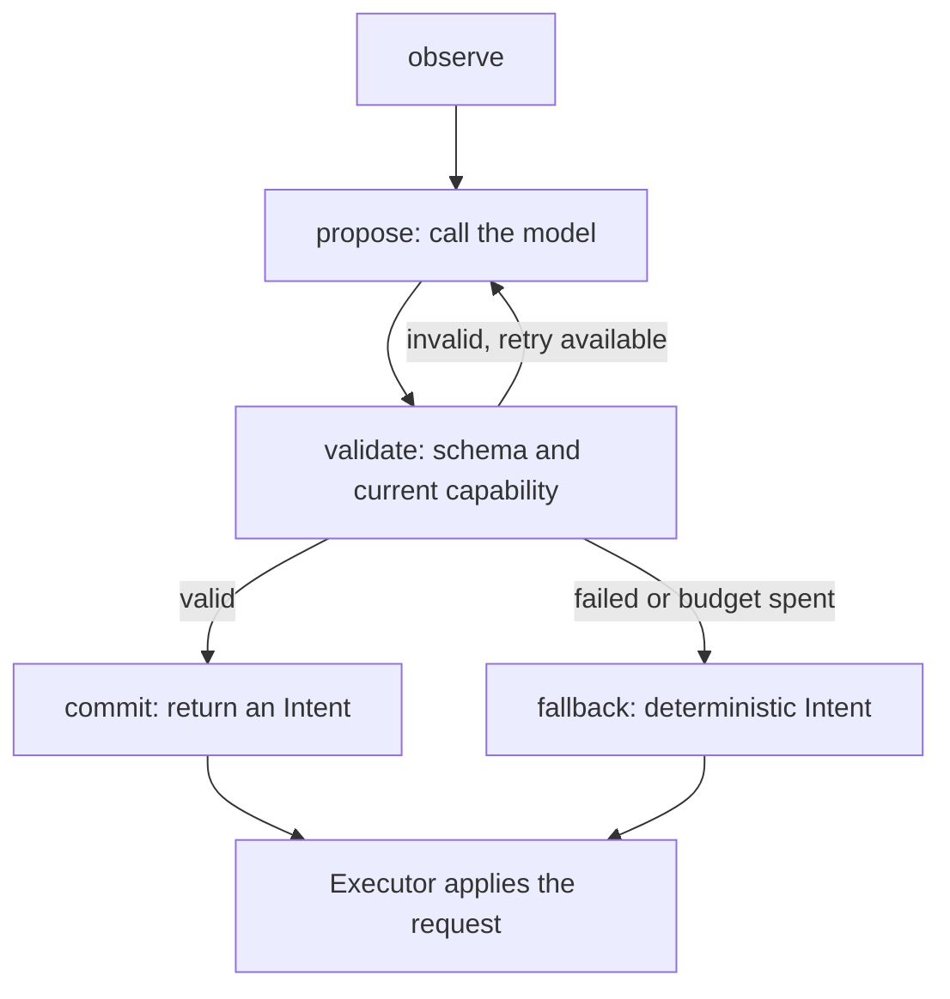

# Apollo Agent: an author's code review

This document explains the implementation as a maintainer would review it: what each layer owns,
why it exists, how data moves, what is correct by construction, and where the evidence ends.
Read it beside the source. Links point to files; function and class names tell you where to look.
The [README](README.md) presents the portfolio project and running guide; this is the design
and code walkthrough. The project was developed for Ed Donner’s AI Agentic Track course.

The central design decision is to separate **reasoning about a flight** from **controlling it at
every physics step**. A model proposes a bounded request. Deterministic code checks that request,
applies it, and measures the consequence. If you understand that boundary, you understand the
architecture well enough to begin changing it.

## Reading route

1. [What this repository owns](#1-what-this-repository-owns)
2. [State ownership and data contracts](#2-state-ownership-and-data-contracts)
3. [Follow the launch command](#3-follow-the-launch-command)
4. [Follow one physics tick](#4-follow-one-physics-tick)
5. [Follow one agent decision](#5-follow-one-agent-decision)
6. [Understand execution and manual control](#6-understand-execution-and-manual-control)
7. [Understand safety and failure](#7-understand-safety-and-failure)
8. [Understand the visible interface](#8-understand-the-visible-interface)
9. [Understand experiments and evidence](#9-understand-experiments-and-evidence)
10. [Review findings and priorities](#10-review-findings-and-priorities)
11. [Make changes as the author](#11-make-changes-as-the-author)
12. [Check your understanding](#12-check-your-understanding)

## 1. What this repository owns

There are two distinct bodies of software:

| Origin | Components | Our relationship to them |
|---|---|---|
| Upstream VirtualAGC | The yaAGC emulator, yaYUL assembler and transcribed Apollo Luminary source. | Pinned Git submodule in `external/virtualagc/`; built and integrated by this project. |
| This application | Physics, emulator integration, scenarios, policies, LangGraph agent, safety, executor, viewer and evaluation. | Python source under `src/luminary_agent/`, plus emulator patches and tests. |

We did not write the historical AGC software. We built an environment around it and a supervisory
agent above that environment. Preserve that distinction when explaining fidelity or attributing credit.

**AGC** means Apollo Guidance Computer. **Luminary** is its Lunar Module flight program.
**Plant** is control-engineering shorthand for the system being controlled: here, the simulated
spacecraft. **Policy** is the software choosing the next intervention. **Episode** means one flight.

The application has two control regimes:

- In **automatic** mode, Luminary supplies guidance and throttle commands interpreted by the simulator.
- In **manual** mode, a Python controller follows velocity targets selected by the policy or safety monitor.

The AGC still executes after manual takeover. Changing control ownership does not replace the AGC
process. Its displayed program and the simulator's control mode are separate facts.

**Review judgment:** using the real flight program gives the experiment a meaningful environment.
The simplified plant and ideal instruments define the scope of this agent-development environment;
results must be interpreted within those assumptions.

## 2. State ownership and data contracts

Before reading algorithms, identify who can change what. Most hard bugs in this project would be
ownership, timing or coordinate mistakes rather than mistakes in the model's prompt.

| Object | Owns | Lifetime |
|---|---|---|
| `Simulation` | Physical state, cross-range state, engine, current control callback, clock and tick count. | One episode. |
| `AgcProcess` / `AgcClient` | Emulator process/commands and socket state, including decoded display and actuator outputs. | One emulator session. |
| `Executor` | Manual controller, capability decisions, accepted policy targets, safety gate and latest execution feedback. | One episode. |
| `SafetyMonitor` | Active violation, override timing and recovery state. | One episode. |
| `FlightAgent` | Model adapter, compiled graph, recent decisions and cumulative usage. | One episode; `reset()` clears decision history and counters. |
| `Recorder` | The open compressed log stream. | One episode. |
| `FrameBuilder` / `Player` | Display metadata and playback position. | One viewer or replay. |

The important contracts are deliberately smaller than those objects:

| Contract | Defined in | Meaning |
|---|---|---|
| `Observation` | [sim/observation.py](src/luminary_agent/sim/observation.py) | Immutable snapshot of what a policy may see. Includes capabilities and previous execution feedback. |
| `FlightDecision` | [policies/agent.py](src/luminary_agent/policies/agent.py) | Pydantic schema for a model response, including a short explanation and next-check interval. |
| `Intent` | [policies/base.py](src/luminary_agent/policies/base.py) | Framework-independent request: kind, parameters, validity deadline, rationale and optional details. |
| `ActionAvailability` | [policies/actions.py](src/luminary_agent/policies/actions.py) | Whether an action is implemented and whether it can be used now. |
| `ActionResult` | [policies/actions.py](src/luminary_agent/policies/actions.py) | What the executor actually did, including ownership before/after and effective parameters. |
| `Control` | [plant/dynamics.py](src/luminary_agent/plant/dynamics.py) | Throttle and thrust direction used by the plant. |
| `ViewFrame` | [viz/view_model.py](src/luminary_agent/viz/view_model.py) | Data needed to draw a frame, without giving the viewer control of the spacecraft. |

`FlightDecision`, `Intent`, and `Control` are different for a reason. The first is a model-facing
response, the second is an application request usable by any policy, and the third is a physics
input. Keeping the conversions explicit prevents model output from becoming actuator input directly.

`Intent` is mutable so the application can attach rationale and audit details. `Observation` is
frozen so policy code cannot alter the supplied snapshot. This is an API boundary, not a sandbox
for hostile Python: a custom policy still runs inside the application's process.

**Invariant to preserve:** policy code receives observations and produces intents. It should never
reach into `Simulation` to change mass, position, control callbacks or AGC memory.

## 3. Follow the launch command

Start with [launch-agent.sh](launch-agent.sh). It is intentionally short:

```sh
./launch-agent.sh
```

Its only jobs are to enter the repository directory, allow 60 seconds per model request, and
execute `uv run --extra agent luminary fly` with local Ollama, `llama3.2:3b` and tier 1 selected.
The `.sh` file is not the agent. `exec` replaces the launcher process with the command it starts.
It neither downloads a model nor starts Ollama; those must already be prepared.

### CLI: choose and wire the application

Read [__main__.py](src/luminary_agent/__main__.py), especially `main()`, `parser()` and `cmd_fly()`.

`parser()` defines the public command vocabulary. `main()` applies explicit model options to the
environment and checks configuration before starting a flight. `cmd_fly()` selects output paths
and assembles arguments for the episode runner.

With a window, it starts a separate descent process using multiprocessing's `spawn` context.
The parent runs pygame. Two queues carry display updates and the final result. With `--no-ui`,
it runs the episode directly instead.

**Why separate processes?** Physics and the emulator exchange many small messages. Rendering in
the same Python process can consume interpreter time and slow that exchange. The queue boundary
lets the viewer fall behind without holding the flight loop hostage.

**Review note:** the CLI should coordinate application components, not contain flight rules.
New control behavior belongs below this layer. Closing the window intentionally does not cancel
the episode; `cmd_fly()` waits for the child before printing the result.

### Episode runner: assemble one experiment

Read [eval/run_episode.py](src/luminary_agent/eval/run_episode.py), function `run()`.
It creates the seeded dispersion, policy, optional safety monitor, terrain, recorder and AGC setup.
It runs the descent, computes the score and returns a result dictionary. The CLI writes the summary
JSON; the recorder writes the detailed episode stream.

This is the application's assembly point. If a dependency must vary between experiments, make
that variation visible here or in the descent's existing injection points rather than burying
an environment check deep inside a physics function.

### AGC build and initial state

[agc/build.py](src/luminary_agent/agc/build.py) builds yaAGC/yaYUL and assembles Luminary.
[sim/snapshot.py](src/luminary_agent/sim/snapshot.py) prepares and caches a pre-ignition state.
[agc/landing_setup.py](src/luminary_agent/agc/landing_setup.py) coordinates mission inputs;
`loads.py`, `padloads.py`, `state_vector.py` and `uplink.py` encode and load them.

The snapshot avoids repeating the same setup for every experiment. Its identity depends on relevant
inputs and artifact contents. It is an AGC startup cache, not a checkpoint of an LLM conversation.
A changed setup must not silently reuse a state prepared by different code.

## 4. Follow one physics tick

Read `Simulation.tick()` in [sim/loop.py](src/luminary_agent/sim/loop.py).
The outer episode loop lives in [sim/descent.py](src/luminary_agent/sim/descent.py), `_fly()`.
These have different responsibilities: `_fly()` decides when to consult policies and terminate;
`tick()` advances the coupled physical/computer state.

One tick is 0.02 simulated seconds:

1. Select control from the manual callback, if installed, or from automatic AGC guidance.
2. Cut thrust if propellant is exhausted; compute thrust and specific force.
3. Integrate the physical state and the separate cross-range channel.
4. Transform sensed specific force into the inertial platform's axes and produce accelerometer pulses.
5. Send those pulses to the AGC, then advance its clock by the tick interval.
6. Record the state and publish an optional view update.

**Specific force** is thrust acceleration measured by the accelerometer, not gravity. Feeding
orbital gravitational acceleration into the accelerometers as if it were thrust would give the
AGC the wrong inertial measurements.

The in-plane dynamics use RK4 integration. The cross-range channel uses a simpler constant-
acceleration update with a restoring gravity term. Therefore, describe the current model as
simplified translational dynamics with a lateral channel, not a complete six-degree-of-freedom LM.
Attitude dynamics are absent; thrust pointing is idealized.

### The two emulator communication paths

| Path | Source | What it carries |
|---|---|---|
| TCP I/O packets | [agc/client.py](src/luminary_agent/agc/client.py), [agc/channels.py](src/luminary_agent/agc/channels.py) | Sensor pulses, switch states and key inputs; display and actuator outputs. |
| Process stdin/stdout | [agc/process.py](src/luminary_agent/agc/process.py) | Debugger commands to step execution and obtain core dumps. |

A socket write completing in Python does not, by itself, prove the emulator consumed those inputs
before a separate stepping command. [agc/handshake.py](src/luminary_agent/agc/handshake.py) and
the emulator patch establish the ordering. Treat that synchronization as a correctness requirement,
not a performance detail to remove during optimization.

[agc/coredump.py](src/luminary_agent/agc/coredump.py) decodes memory snapshots;
[agc/symbols.py](src/luminary_agent/agc/symbols.py) maps names from the assembler listing to addresses;
[agc/guidance.py](src/luminary_agent/agc/guidance.py) reads the relevant guidance values.
Those internal reads support integration. The agent receives the observation contract, not the dump.

**Debugging rule:** if the trajectory is wrong even with `--policy null`, begin with physics,
coordinates, actuator interpretation and AGC setup. Prompt changes cannot correct a unit-conversion bug.

## 5. Follow one agent decision

### When the model is consulted

[sim/events.py](src/luminary_agent/sim/events.py) implements `Trigger`. It asks for a decision
on program/alarm/mode/radar-lock changes, intent expiry or the five-second heartbeat, with a minimum
half-second gap between calls. A long model revisit interval does not override the heartbeat.
An active safety latch can postpone policy consultation.

`_consult()` in [sim/descent.py](src/luminary_agent/sim/descent.py) waits for the policy while
simulated time is stopped. `DecisionRunner` runs the synchronous policy method in a daemon worker
so the asynchronous application can receive progress and enforce a wall-clock timeout.

### What LangGraph contributes

Read [policies/agent.py](src/luminary_agent/policies/agent.py) in this order:

1. `FlightDecision`: what shape a response must have.
2. `SYSTEM_PROMPT`: the operational task, signs, limitations and explanation requirements.
3. `build_model()`: LangChain's provider-specific adapter and structured-output interface.
4. `FlightAgent.__init__()`: the nodes and edges of the compiled `StateGraph`.
5. `_propose()`, `_validate()`, `_route()`: request, application validation and routing.
6. `_commit()`, `_fallback()`, `decide()`: produce the intent and update bounded history.



LangGraph owns the bounded workflow. LangChain owns provider adaptation. Pydantic checks response
shape. The application owns semantics, authority and spacecraft mutation. Installing an agent
framework does not supply these domain rules automatically.

The graph is re-entered for each consultation. It is not an independent process flying alongside
the simulator. The `FlightAgent` instance retains its recent history between calls; the graph state
contains the observation, proposal, validation error, attempt count, path and resulting intent for
one decision. There is no durable LangGraph checkpointer or model training loop.

### Why there are multiple validation layers

A JSON object can be well-formed while still requesting an impossible operation.

| Layer | Example of a failure it catches |
|---|---|
| `FlightDecision` | Missing rationale, unknown top-level field, invalid revisit interval. |
| `validate_intent()` / `ACTION_SPECS` | Wrong action parameters, nonfinite values, invalid action vocabulary. |
| Current capability list | `command` before manual takeover; a recognized but unimplemented abort. |
| Executor validation and safety gate | A direct/custom policy request that bypassed the graph's checks. |
| Controller bounds | A finite velocity request beyond the supported target range. |

Clamping is different from rejection: the executor records the **effective** targets so the model
can see what was actually accepted. Do not infer successful execution from schema validity alone.

### A concrete example you can trace

Assume the observation says manual mode, current time 100 s and an available `command` action.
The model proposes descent at −1 m/s, zero along-track speed and zero cross-range speed, with a
2-second revisit interval.

`_validate()` builds `Intent("command", params, 102, rationale)`. `_commit()` attaches operational
summaries, graph path and usage. `_consult()` validates the returned intent and invokes `_act()`.
The executor calls `ManualController.set_targets()`, then returns `ActionResult` with the accepted
values. `_act()` records the observation, request and execution together. The next tick uses the
updated controller; the next observation supplies feedback to the policy.

The deadline means “consult again when this decision expires.” It is not a motor cutoff timer:
existing targets persist until another accepted command changes them. When extending the system,
do not assume `valid_until_s` automatically resets control.

## 6. Understand execution and manual control

[sim/executor.py](src/luminary_agent/sim/executor.py) is the mutation boundary.
`execute()` validates, checks support/availability, applies the request and constructs structured
feedback. `apply()` returns a text summary of the same result and is used by the descent loop.

A useful distinction is **supported** versus **available**. A command can be implemented but unavailable
in automatic mode. Abort can be recognized by the vocabulary but unsupported by the backend entirely.

`take_manual` writes the AUTO THROTTLE switch state and installs a manual-control callback on the
simulation. Its result explicitly says “P67 requested.” The immediate control-ownership change
is observable; the AGC's later program transition must be observed separately.

`command` sets all three velocity targets. Omitted vertical rate selects the default altitude
schedule; omitted horizontal components become zero. It is not a partial patch that preserves
unspecified axis targets. `hold` preserves the current targets and ownership.

### The controller behind a velocity request

Read [sim/manual_control.py](src/luminary_agent/sim/manual_control.py), `control_3d()`.
Its basic idea is proportional velocity feedback:

```text
wanted acceleration = (target velocity - current velocity) / response time
```

The implementation adds gravity and coordinate corrections, limits sideways acceleration to the
shared tilt budget, then converts the acceleration vector into thrust and direction. Throttle
and velocity targets are bounded. Smaller response-time constants make corrections more aggressive.

This controller is not a position autopilot. If the agent only requests zero horizontal speed,
the lander may touch down gently away from the target. To close target error, a policy must select
appropriate nonzero velocity targets and later brake. Cross-range and along-track demands compete
for the same thrust vector; they are not independent engines.

### AGC procedures are a separate extension point

[sim/operations.py](src/luminary_agent/sim/operations.py) defines `FlightOperations` and the current
`AgcOperations` implementation. A backend advertises prerequisites and executes supported procedures.
Today, individual DSKY keys are submitted with rate limits. A multi-key procedure needs sequencing,
observation and confirmation; “the keys were sent” cannot stand in for “the maneuver succeeded.”

Do not add a prompt instruction claiming P66, redesignation, handback or abort works before the
backend, dynamics and evaluator actually support that procedure. Raw keyboard access is low-level
and can change programs, but it does not create missing staging or ascent physics.

## 7. Understand safety and failure

### Safety retains authority across ticks

Read [safety/monitor.py](src/luminary_agent/safety/monitor.py). It checks a descent-rate envelope
and excessive total horizontal speed near the ground. Altitude comes from radar, or the AGC when
radar is unavailable. It is a limited deterministic monitor, not a proof that every possible action
or trajectory is safe.

The monitor distinguishes “a violation remains active” from “a new override record must be emitted.”
Repeated messages are throttled, but the authority latch stays active between them. Otherwise the
agent could issue conflicting commands during the quiet interval between override logs.

The loop checks safety before consulting the policy. The executor separately refuses conflicting
policy actions while the latch is active. When the envelope recovers, prior accepted policy targets
are restored. Hysteresis requires recovery comfortably inside the limit, reducing oscillation.
Losing both altitude readings does not release an existing latch.

**Review judgment:** the authority latch is a stronger design than merely logging vetoes. However,
the monitor relies on imperfect observations and does not guarantee hazard avoidance or propellant
sufficiency. Never interpret a passing flight as evidence of comprehensive safety coverage.

### Two fallback paths have different meanings

| Failure | Handling | Can the model be tried again this episode? |
|---|---|---|
| Model exception, malformed response or unavailable proposal inside the graph | At most one repair, then labelled deterministic fallback. | Yes, if a future consultation has call budget. |
| Model-call budget exhausted | No further inference; deterministic graph fallback. | No new model calls until a new/reset episode. |
| Outer worker timeout or uncaught policy failure | `_consult()` disables the runner and uses automatic hold or default manual commands. | No; the policy is quarantined for the episode. |
| Executor/backend I/O failure | Return `failed`; report feedback. | The failure is observed later; mutation is not blindly retried. |

The graph's automatic-mode fallback uses the scripted takeover policy. The outer failure handler
holds automatic guidance instead. These are intentionally distinct paths in the current code;
include that difference when diagnosing a flight from its logs.

Python cannot forcibly stop a worker thread safely. A timed-out model request can still finish,
but its result is discarded. This is why workers must compute intents rather than mutate the plant.
Provider exception text is sanitized inside the graph to avoid recording raw response/connection
content; the code does not claim arbitrary custom-policy exceptions are similarly sanitized.

## 8. Understand the visible interface

The viewer has three separable concerns:

| Layer | Files | Role |
|---|---|---|
| Transport | [viz/live.py](src/luminary_agent/viz/live.py) | Nonblocking bounded queue; publish recent frames and model progress. |
| Data conversion | [viz/view_model.py](src/luminary_agent/viz/view_model.py), [viz/replay.py](src/luminary_agent/viz/replay.py) | Convert records into `ViewFrame`; use the same representation for live and saved flights. |
| Interaction/rendering | [viz/native_app.py](src/luminary_agent/viz/native_app.py), [viz/native_renderer.py](src/luminary_agent/viz/native_renderer.py) | Playback, keyboard controls, geometry, plots and inspector. |

`FrameBuilder` keeps the latest decision metadata and copies it into subsequent frames. Therefore,
a new physics tick need not repeat a model request to display its latest intent. Agent progress can
also republish the last tick immediately while simulated time is frozen for inference.

The queue can drop older display updates if the viewer is slow. The recorder is independent and
keeps the episode records. This is a deliberate tradeoff: responsive viewing over perfect delivery
of every live frame, with the log as the audit source.

`Player` owns playback time. Pressing Space pauses the view, not the simulation. Pressing `I` shows
an overlay with model summaries and actual observations/results. Summary evidence is generated by
the model; the “observed” and “execution” sections come from application state. Keep those origins
visually distinguishable when adding UI fields.

Replay reconstructs final state at each simulation timestamp. Intermediate inference stages happen
at the same frozen timestamp and remain in the log rather than playing back in original wall time.
The display is an inspection surface, not a flight-command console.

## 9. Understand experiments and evidence

[scenarios/dispersions.py](src/luminary_agent/scenarios/dispersions.py) samples seeded scenario
variation. [eval/sets.py](src/luminary_agent/eval/sets.py) defines development and frozen sets.
[eval/run_set.py](src/luminary_agent/eval/run_set.py) coordinates batches, and
[eval/report.py](src/luminary_agent/eval/report.py) summarizes them.

A seed controls the scenario. It does not control arbitrary model responses. Record provider,
model, prompt/configuration and code versions before comparing LLM policies. The evaluation
fingerprint prevents accidentally combining cached results from changed experiments; it does not
make a hosted model version or an Ollama model tag immutable.

[eval/score.py](src/luminary_agent/eval/score.py) separates physical touchdown from mission success.
Total horizontal speed includes both axes. Target distance, slope and hazards matter to the mission
verdict even when contact speed is gentle. The target rotates with the Moon; observation, trajectory
and score must use the same reference epoch and coordinate convention.

[sim/recorder.py](src/luminary_agent/sim/recorder.py) writes compressed JSONL. A `decision` record
contains the observation, requested intent, source and actual execution. `agent_status` contains
workflow progress. The header records provenance, and the final landing record contains the score.
A log is evidence of what happened; it is not a resumable agent checkpoint.

### What the test suite proves

| Evidence | Relevant tests | Interpretation |
|---|---|---|
| Graph commits, repairs and falls back correctly under controlled replies | [test_flight_agent.py](tests/unit/test_flight_agent.py) | Workflow and validation behavior, not model intelligence. |
| Action capability/execution rules and failure feedback | [test_flight_actions.py](tests/unit/test_flight_actions.py) | Application control boundary behavior under tested inputs. |
| Inspector/live/replay conversion | [test_agent_inspector.py](tests/unit/test_agent_inspector.py) | Observable state survives recording and rendering. |
| Actual LangGraph through a real-AGC descent | [test_agent_descent.py](tests/integration/test_agent_descent.py) | End-to-end integration with a deliberately controlled fixture model. |
| Trajectory and score agree | [test_descent_smoke.py](tests/integration/test_descent_smoke.py) | Coordinate/scoring consistency for the exercised descent. |
| Emulator stepping and I/O ordering | [test_determinism.py](tests/integration/test_determinism.py), [test_stepped_stress.py](tests/integration/test_stepped_stress.py) | Synchronization under the tested conditions. |

The last implementation checkpoint passed 345 unit and 19 integration tests. This document's
review does not turn those tests into a real-model benchmark. No model landing-success rate is
established by those results. The fixture flight had soft touchdown but failed the target criterion.

## 10. Review findings and priorities

These are review conclusions and follow-up work, not claims that every limitation has been fixed.

### Keep: the explicit mutation and evidence boundaries

The separation of observation, intent, executor and result is the strongest architectural choice.
It allows deterministic policies, model policies and future backends to share the same control
contract. Recording requested versus effective actions makes clamp/rejection behavior inspectable.
Preserve these boundaries when simplifying code.

### Priority 1: establish actual local-model behavior

The graph can work correctly while a model repeatedly emits invalid actions or relies on fallback.
Run a small, separately stored development evaluation with the actual Ollama model. Compare against
`scripted` on the same seeds. Review mission success, soft touchdown, target error, fuel, safety
interventions, fallback counts, calls and wall latency together. Successful model loading is only
a connectivity check.

### Priority 1: keep fidelity claims tied to the implemented plant

Manual control uses ideal state; only radar has the declared faults. The AGC does not receive
landing-radar updates, thrust pointing is ideal, and terrain affects scoring rather than contact
physics. These simplifications can materially change which strategies work. Improve the sensor/
vehicle model before treating results as evidence about an actual LM.

### Priority 2: add a deterministic target-seeking comparison

The current scripted policy is useful for takeover timing and velocity stabilization. It does not
actively steer toward the target. A small deterministic position-to-velocity policy would distinguish
“the model can improve target acquisition” from “any target-seeking controller beats velocity nulling.”
Do not attribute all improvement over the existing baseline to language-model reasoning.

### Priority 2: model reproducibility and diagnostics

Provider and model names, prompt hashes and usage are recorded, but names alone do not uniquely pin
model weights or all generation behavior. Future experiment metadata should capture local model
identity and supported generation settings. Distinguish server failures, parse failures and rejected
actions in analysis; a fallback count alone cannot explain the cause.

### Priority 2: define cancellation as a separate feature

Closing the viewer currently leaves the flight running. This is documented behavior, but a user
may expect “close” to stop local inference too. A future cancellation feature needs an explicit
message to the simulation, orderly recorder/emulator cleanup and a recorded cancellation outcome.
Killing the window process is not a complete cancellation design.

### Priority 3: reduce orchestration coupling when it grows

`sim/descent.py` currently coordinates observation, safety, triggering, policy execution, recording
and termination. That makes it the best reading entry point and a likely future complexity hotspot.
Extract cohesive components when adding mission phases or procedures; do not split it merely to
reduce line count. Keep decision/execution ordering visible and tested.

### Priority 3: treat unsupported procedures as real projects

Handback, P66 control, redesignation and abort require prerequisites, multi-tick execution,
confirmation and failure semantics. Abort also needs appropriate dynamics and scoring. The existing
capability/backend seam is preparation for that work, not evidence the work is complete.

## 11. Make changes as the author

For any change, write down its contract before changing the prompt or implementation:

1. **Input:** what observation or state does this behavior require?
2. **Authority:** which component may apply the change, and can safety override it?
3. **Output:** what result proves delivery, execution or success?
4. **Failure:** what happens on invalid input, timeout or partial I/O failure?
5. **Evidence:** which log record and test would show a regression?

Three concrete examples:

| Change | Implementation route | Meaningful verification |
|---|---|---|
| Let the agent compensate for cross-range target offset | Adjust decision logic/prompt; use the existing `cross_ms` target. Keep signs explicit. | Known positive/negative offsets; inspect effective command, later motion and final target error. |
| Add a new sensor reading | Define its source/fault model in `Observation`, serialize it, then expose it to model and viewer. | Check hidden/unavailable cases and consistency between live observation and replay. |
| Add an AGC procedure | Schema in `actions.py`, prerequisites/execution in the backend, feedback through executor. | Real-emulator transition and confirmation, rejection before prerequisites, interruption/failure behavior. |

Run focused tests while editing, then relevant integration tests. Build the emulator before claiming
full integration coverage. For documentation or a launcher-only change, syntax/link checks and a
stubbed command invocation are more useful than rerunning an expensive flight.

Useful commands from the repository root:

```sh
./launch-agent.sh
uv run --extra agent pytest tests/unit/test_flight_agent.py tests/unit/test_flight_actions.py -q
make agc
uv run --extra agent pytest -q
make lint
```

Use a fresh output directory for performance experiments. Keep the frozen set for final evaluation;
use development seeds while changing policy behavior.

## 12. Check your understanding

You should be able to answer these without guessing:

- **Why can the interface respond while the model is slow?** The viewer is a separate process;
  inference runs in a worker while the simulator's async loop can deliver progress.
- **Why is the spacecraft stationary during a model request?** Simulated stepping is paused;
  wall-clock inference delay is not integrated into the trajectory.
- **Why validate twice?** The graph checks its own proposal; the executor must also protect the
  mutation boundary for every policy, including custom non-LLM implementations.
- **Why can a valid action still fail?** Preconditions, authority or backend I/O can prevent execution.
- **Why can a soft landing fail the mission?** Target distance, hazards and slope are separate criteria.
- **Why is `hold` not “stop”?** It preserves the current controller and targets; physics continues.
- **Why can't we enable abort by adding it to the prompt?** Guidance inputs, staging/ascent dynamics
  and success criteria must exist and be verified first.
- **Where would you debug a bad decision?** Start with its logged observation, capability list,
  proposal, validation/fallback path and execution result; then follow the resulting trajectory.

When these answers feel natural, you can explain the code from its contracts and invariants rather
than memorizing filenames. That is the useful level of ownership for extending the project.


---

# Policy control and decision inspection

The LangGraph agent is a supervisory pilot: monitor the flight, identify discrepancies, decide
whether to intervene, select achievable velocity targets, and check whether its action worked.
The AGC runs the original guidance software. The deterministic simulation advances both the
AGC and the spacecraft; a policy cannot rewrite either one.

## Responsibility and authority

| Layer | Responsibility | Current authority |
|---|---|---|
| Luminary / AGC | Navigation and landing guidance in automatic mode | Engine on/off, throttle increments, commanded thrust direction |
| Policy (scripted or LangGraph) | Choose interventions and supported targets | Requests described by the action catalog; capability discovery in each observation |
| Executor | Validate requests, arbitrate authority, route procedures, report outcomes | Three-axis manual targets and a pluggable `FlightOperations` backend |
| Manual controller | Follow velocity targets every physics step | Throttle and thrust direction in the orbital plane and cross-range, using ideal state |
| Safety monitor | Retain authority while an observed envelope violation persists | Override targets and null both horizontal velocity components; restore prior targets after recovery |

## Action catalog and actual support

A recognized action can still be unsupported by the installed backend. This distinction is
part of the API. The LangGraph policy checks capability availability before committing a proposal.

| Request | Parameters | Current backend |
|---|---|---|
| `hold` | None | Applied: keep controller and targets; does not stop the spacecraft |
| `take_manual` | None | Applied: clear AUTO THROTTLE and activate the manual controller; P67 is requested, not falsely confirmed |
| `command` | `descent_rate_ms`, `horizontal_ms`, `cross_ms` | Applied only in manual mode; follow three velocity targets |
| `dsky_key` | One named `key` | Submitted to AGC channel 015; subsequent display observations show what the AGC did |
| `return_auto` | None | Unsupported: P67 hands back to P66, requiring validated P66 loads and synchronized throttle state |
| `select_p66` | None | Unsupported: requires a verified mode transition and validated rate-of-descent controller loads |
| `adjust_rod` | Integer `clicks`, -10..10 | Unsupported: requires MARKRUPT, P66 and verified ROD input handling |
| `redesignate` | `downrange_m`, `cross_m`, each -1000..1000 | Unsupported: AGC aim-point offsets require MARKRUPT and a verified landing-point update |
| `abort` | `stage`: `descent` or `ascent` | Unsupported: requires abort guidance, stage/engine dynamics and a separate abort-success evaluator |

Manual velocity limits are -6..0 m/s vertically and -5..5 m/s for each horizontal component.
A `None` descent rate selects the existing altitude schedule. The two horizontal axes share
the same tilt limit and total thrust budget. Cross-range acceleration also reaches the AGC
through PIPA measurements. The default manual controller now arrests cross-range drift.

The current handover is still irreversible operationally; adding a `return_auto` request to the
vocabulary does not make a valid handover available. Luminary's `GUILDENSTERN` monitor explicitly
selects P66 when manual throttle disappears in P67
(`external/virtualagc/Luminary099/LUNAR_LANDING_GUIDANCE_EQUATIONS.agc:140`).
`mode` in observations describes control ownership (AGC or manual); `program` separately reports
the actual AGC program. A future P66 backend must preserve that distinction.

Redesignation offsets are relative to the current AGC aim point. A future backend must keep that
aim point separate from the original mission target and terrain coordinates: moving the aim point
must not silently move hazards or make the mission-success distance zero.

DSKY accepts the keyboard names in `agc/dsky.py:KEYCODE`; `PRO` is not in that channel-015 map.
It accepts one key per request, with at least 0.12 simulated seconds between keys. It never steps
only the AGC, so normal ticks still run physics, safety and termination checks. `submitted` means
delivery, not confirmation of a command or maneuver. Raw keys can change AGC programs or trigger
alarms; they do not supply the missing P66/abort physics or bypass the safety latch.

## Extending the backend

`policies/actions.py` owns schemas, descriptions, capability records and result statuses.
`policies/base.py` provides the `Intent` constructors. `sim/executor.py` owns validation, authority
and routing. `sim/operations.py:FlightOperations` is the extension protocol for AGC/vehicle
procedures. The default `AgcOperations` backend supports keyboard delivery and reports why the
other procedures are unsupported.

A backend implements `availability(action, context)` and `execute(intent, context)`. The context
contains simulation time, control ownership and observed AGC program. Inject it with
`Executor(..., operations=backend)`, or supply
`run_descent(..., operations_factory=lambda sim, client: MyBackend(sim, client))`.

Availability must reflect prerequisites and observed mode. Execution returns a structured status:
`applied`, `submitted`, `rejected`, `unsupported`, `ignored`, or `failed`. The executor adds actual
before/after ownership and effective parameters, exposes the result in the next observation, and
writes it to the decision log. An I/O exception is `failed` and is never automatically retried:
the first attempt may already have changed hardware inputs.

A concrete backend is responsible for implementing and validating its missing AGC inputs and
physical models. Merely registering support is not sufficient. Multi-tick procedures must preserve
plant/AGC lockstep and allow safety checks between ticks. Abort additionally needs mission-phase
and termination/scoring work; the existing landing runner stops when Luminary leaves landing
programs, and that `aborted` result is **not** proof of a successful ascent or crew survival.

A useful first agent exercise is deciding takeover timing and adjusting both horizontal velocity
targets while preserving propellant and a gentle touchdown. A target-seeking deterministic baseline
should be evaluated alongside it. The capability API allows later agents to adapt to additional
backends without changing their observation/action contract.

## Explicit instrument model

The declared model is `ideal_state_with_faulted_radar`. Radar altitude has seeded noise, bias
and dropout. Velocity, mass, propellant and visible target geometry are ideal state instruments;
the manual controller also uses ideal state. Thus a radar dropout does **not** deprive the manual
controller of altitude knowledge. This is an explicit simulation simplification, not a sensor-failure
flight-fidelity claim. The observation, log header, result and viewer identify this model.

## Validation, feedback and failure

Intents must have a supported kind and fields, finite numeric values, and a validity deadline
strictly in the future and no more than 60 simulated seconds away. The policy gets the previous
execution result and supported/available action catalog in its next observation. Numeric values outside actuator bounds are clamped and
reported. Invalid shapes, unknown fields, NaN and infinity are rejected before controller mutation.

Policy reset and decision run in a daemon worker. Baseline policies have a 30-second wall-clock
timeout; the LLM policy allows twice its request timeout plus five seconds. Unhandled errors,
invalid final intents or timeouts quarantine that policy for the episode; the fallback holds automatic
guidance or restores the manual controller's default descent schedule. Safety retains priority.
Python cannot terminate a running thread: policies must only compute an intent and must not
mutate the spacecraft. A timed-out model request may finish, but its result is discarded. The executor is the sole spacecraft mutation boundary. This is a bounded
simulation API, not an isolation mechanism for untrusted executable code.

A standing safety violation blocks policy consultations even between deduplicated override logs.
Loss of both altitude sources does not release an existing safety latch. Releasing the latch
restores the previously accepted policy targets instead of silently resetting them.

## Decision inspector

The live/replay window has a dedicated panel showing source (policy, safety or fallback), decision
time, validity, wall latency, proposed action, trigger, a concise policy-supplied rationale,
execution status/result and the actions available at decision time. Horizontal telemetry includes
along-track and cross-range velocity. Scripted policies explain their rule; the LLM supplies a concise rationale, evidence, risks and
next-step plan. These are operational summaries, not private model reasoning.

Press **I** for the detailed inspector and **[ / ]** to move between decisions (pauses the view).
It shows the graph path, model, call and reported token counts, evidence, risks, plan and recent
execution history. Live progress updates continue while physics is paused for inference.
Pause with Space or scrub with the arrow keys to inspect a moment. The live flight continues in
its separate process while the viewer is paused. Full rationale and action records remain in the
JSONL episode log; long text is abbreviated in the panel. Legacy logs remain replayable and are
labelled with an unspecified instrument model when the metadata is absent.

## Corrected evaluation semantics

The target and terrain rotate with the Moon from the site's TLAND reference epoch. Observations,
tick records, the viewer and final scoring use the same time-dependent site position. Touchdown
horizontal speed includes both along-track and cross-range velocity. Terrain contact is still a
flat altitude-zero plane; slopes and obstacles affect scoring only.

Batch resumption verifies a fingerprint of the configuration, actual Python sources, dependency
files and AGC artifacts. A mismatching or legacy cache is rejected with a request to use a fresh
output directory. Nothing silently overwrites the old experiment. The AGC snapshot is keyed by
content, and the batch prepares it before launching parallel workers.

The previous baseline table predates these corrections. Regenerate development results before
using them to compare policies; previously reported mission-success counts are historical.


## Running the LangGraph policy

Install the optional dependencies and select a model available through your provider:

```sh
uv sync --extra agent
# Set OPENAI_API_KEY in your local environment first.
uv run --extra agent luminary fly --policy llm --provider openai --model YOUR_MODEL --tier 1
# Or use a locally installed Ollama model with structured-output support:
uv run --extra agent luminary fly --policy llm --provider ollama --model YOUR_LOCAL_MODEL --tier 1
```

Anthropic uses `--provider anthropic` and `ANTHROPIC_API_KEY`. OpenAI-compatible endpoints use
`--provider openai --base-url URL` with `OPENAI_API_KEY` as required by that server. Model names
are deliberately explicit. The agent extra is required for agent runs, not for baseline flights
or replay. Provider/model compatibility and flight performance must be evaluated with your model.

The CLI flags also work with `luminary eval`; use a fresh output directory per experiment.
Environment equivalents are `LUMINARY_PROVIDER`, `LUMINARY_MODEL`, `LUMINARY_BASE_URL`,
`LUMINARY_MAX_CALLS` (default 200), `LUMINARY_REQUEST_TIMEOUT_S` (default 10), and
`LUMINARY_MAX_OUTPUT_TOKENS` (default 1200). `--max-model-calls` overrides the per-episode budget.
Provider keys and endpoint URLs are not written to logs; the endpoint is fingerprinted by hash.
When a remote provider is selected, flight observations and bounded recent decision history are
sent to that provider. No AGC memory or credentials are included in the model prompt.

The compiled workflow is `observe → propose → validate → commit`, with one repair attempt after
an invalid, unavailable or failed response. Each request uses a structured LangChain response;
the deterministic schemas and current capability list remain authoritative. The graph carries
the last eight decisions into the next consultation and checks actual execution feedback.
Only the executor can apply an intent. The AGC continues to provide automatic guidance until
manual takeover; the agent does not replace the physics-rate controller.

Both attempts count against the episode call budget. Provider retries are disabled where
configurable. After two failed attempts, or budget exhaustion, the graph returns an explicitly
labelled deterministic fallback: scripted takeover logic in automatic mode, default descent and
zero horizontal targets in manual mode. A later consultation may recover from a transient model
failure; an outer worker timeout instead quarantines the policy for the remainder of the episode.
The existing safety monitor always takes priority. Model latency costs wall time, not simulated time.

Every decision records the proposal, execution result, operational summary, graph path, model,
attempt count and cumulative calls/reported tokens. Progress records use `type: agent_status`.
Replay keeps final state at each simulation timestamp; intermediate inference stages remain in the
log, since they occur at the same frozen simulation time. Logs contain enough data to audit a
flight, but are not resumable LangGraph checkpoints. Model responses are not deterministic.

```sh
uv run luminary view results/runs/t1_s0_llm.jsonl.gz
uv run luminary view results/runs/t1_s0_llm.jsonl.gz --screenshot agent.png --inspect
```

Tests inject controlled model responses through the actual compiled graph. The full descent
integration test runs the real AGC with a model labelled `fixture/no-llm`; it verifies execution,
logging and replay plumbing, not LLM landing performance. A real-provider evaluation requires
locally configured credentials (or an available Ollama model).


---

# AGC ↔ plant integration: units, signs, scaling, channel

What crosses the boundary between the real Luminary 099 rope (running in yaAGC) and the Python
plant, one row per signal. Source of truth is the code named in each row; every row names the unit
test that pins it analytically and the integration test that pins it against a real yaAGC.
Integration tests need `127.0.0.1` sockets: `uv run pytest tests/integration -q`.

## Plant → AGC (sensors and discretes)

| Signal | AGC address | Unit / scale | Sign / frame | Code | Unit test | Integration test |
|---|---|---|---|---|---|---|
| PIPA X/Y/Z (accelerometer) | counter regs `0o37/0o40/0o41` via `0x80 \| reg`, `PINC`/`MINC` | 1 pulse = 0.01 m/s (`KPIP1`: 2⁻¹⁴·.0128·2⁷ m/cs); fractional remainder carried | specific force in stable-member axes, ones' complement counter | `plant/sensors.py`, `agc/registers.py` | `test_sensors.py`, `test_registers.py` | `test_pipa_pulses_against_real_yaagc.py` |
| CDU X/Y/Z (gimbal angles) | counter regs `0o32/0o33/0o34`, `PCDU`/`MCDU` (fast: `0o21/0o23`) | 1 pulse = 360/32768° (2¹⁵ per rev); THETAD in the same counts | 2's-complement mod 2¹⁵; seeded at the burn attitude (P63 R60LEM becomes a no-op) | `agc/cdu.py`, `plant/sensors.py` | `test_cdu.py`, `test_sensors.py` | `test_coredump_against_real_yaagc.py` |
| Hardware discretes | input channels `0o30`–`0o33` | bit flags, **inverted as sensed** (0 = present) | see `plant/discretes.py` for the named bits (IMU operate, LGC control, ATT HOLD/AUTO, LR position/data-good) | `plant/discretes.py` | `test_discretes.py` | `test_discretes_against_real_yaagc.py` |
| State vector / pad loads | erasable via uplink (P27) | DP, B-scaled (m B-27, m/cs B-5, cs B-28) | lunar-sphere inertial | `agc/state_vector.py`, `agc/scaling.py`, `agc/padloads.py`, `agc/uplink.py` | `test_state_vector.py`, `test_scaling.py`, `test_padloads.py`, `test_uplink_validation.py` | `test_state_vector_p27.py`, `test_padloads_p27.py`, `test_uplink_p27.py` |
| DSKY keys | input channel `0o15` | keycode (`agc/dsky.py:KEYCODE`) | – | `agc/dsky.py`, `agc/stepped_dsky.py` | `test_dsky.py` | `test_stepped_mode.py` |
| **Landing radar** | **none** | – | – | `plant/radar.py` | `test_radar.py` | – |

**Radar boundary (deliberate).** yaAGC's socket build has no radar data path. Radar altitude
(bias, noise, dropout band) reaches the *observation* only, so the AGC keeps flying its belief
and the agent/crew must decide which to trust. There is no `RNRAD` write; do not describe
Luminary as "using" the radar in this simulator.

## AGC → plant (actuators and readouts)

| Signal | AGC address | Unit / scale | Sign / semantics | Code | Unit test | Integration test |
|---|---|---|---|---|---|---|
| Engine ON/OFF | output channel `0o11` bits 13/14 | momentary relay pulses | ON sets, OFF clears | `agc/actuators.py` | `test_actuators.py` | `test_gate0_mission_timer.py` |
| Throttle command | `THRUST` erasable (increment `PIF = FC − FP`) + strobe channel `0o14` bit 4 | counts; 1 count = 12.533 N; slew `FRATE` 32 counts/cs; clamp min throttle … `FMAX` | an *increment*, not a level; accumulated as pending command, rate-limited | `plant/throttle.py`, `sim/loop.py` | `test_throttle.py`, `test_loop_throttle.py`, `test_propulsion.py` | `test_sim_loop_coasting.py` |
| Thrust direction | `UNFC/2` (core dump) | unit vector, stable-member frame | rotated to the lunar frame by `plant/lunar_orientation.py` | `sim/loop.py`, `agc/guidance.py`, `plant/lunar_orientation.py` | `test_lunar_orientation.py`, `test_dynamics.py` | `test_sim_loop_coasting.py` |
| RCS jets | output channels `0o5` (pitch), `0o6` (roll) | raw 8-bit jet patterns | **logged only**, not mapped to torque | `agc/actuators.py` | `test_actuators.py` | – |
| DSKY display | output channel `0o10` | 7-segment words `AAAABCCCCCDDDDD` | decoded to verb/noun/R1–R3, alarms | `agc/dsky.py` | `test_dsky.py` | `test_stepped_mode.py` |
| Guidance readouts (altitude, program, alarms) | core dump (`COREDUMP`) via `agc/symbols.py` (addresses from the yaYUL listing, never hard-coded) | see `agc/coredump.py` | erasable banks, ones' complement | `agc/coredump.py`, `agc/symbols.py` | `test_coredump.py`, `test_symbols.py` | `test_coredump_against_real_yaagc.py` |

## Plant model and MVP boundary (decided)

- **3-DoF**: planar (down-range/altitude) plus a lateral channel driven by Luminary's own thrust
  command; commanded pitch, no attitude dynamics. Mass flow, gravity, rotating surface, DPS,
  incremental throttle are modelled.
- **Out of scope until frame/attitude tests exist**: 6-DoF, RCS torque, jet-to-axis mapping,
  abort, P66/LPD, RCS failure, 1201/1202. They are separate capabilities, not S1 leftovers.
- **Time**: stepped clock (`sim/clock.py`); the AGC only executes when the loop steps it, and the
  free-run yaAGC patch removes host-side pacing only (TIME1/TIME2 come from counter interrupts).
- **Scoring**: `soft_touchdown` is computed; `mission_success` stays `not_scored` until the surface
  model (S2) exposes target, hazard and slope.


---

> Historical results: these precede the rotating-target, cross-range scoring and safety-authority fixes. Regenerate before comparing policies.

# Simulator Scenarios (Phase S4)

Each scenario is a **knob** in `scenarios/dispersions.py` or the seeded surface (`plant/terrain.py`), chosen only if the crew can **observe** the symptom and **change** the outcome with an action supported by the simulator today (S4 rule: no event that the crew cannot read or modify). Knobs are deterministic: `sample(seed, tier)` and `Surface.sample(seed)` with the same seed produce the same results (see tests below).

Source labels, as in `CODE_REVIEW.md`: **[rope]** verified in the submodule Luminary code, **[measured]** measured in this repository, **[doc]** public source *named but not verified* (no network). A `[doc]` claim is a lead, not evidence.

Executable actions (`policies/base.py`): `hold`, `take_manual`, `command(descent_rate_ms, horizontal_ms, cross_ms)`, and individual `dsky_key` inputs. The action catalog also recognizes handback, P66/ROD, redesignation and abort requests, but the current backend reports them as unsupported with explicit prerequisites. See [the capability contract](CODE_REVIEW.md).

## Scenario Table

| # | Scenario | Seed / Knob | Observable (for agent) | Available Action | Source | Expected Outcome | Test |
|---|---|---|---|---|---|---|---|
| S-1 | **Initial State Error**: plant starts differently from what AGC believes; AGC never discovers it | `Dispersion.dh0_m`, `dvt0_ms`, `dvh0_ms` (T1: 0m / 0.005m/s; T2: ±10m / 0.02; T3: ±100m / 0.3) | radar altitude vs AGC altitude (`Observation.radar_altitude_m`, `agc_altitude_m`, DSKY N63/N64 R3) diverge | `take_manual`, then `command(descent_rate_ms=…)` while monitoring radar | **[measured]** ~700m forward error per m/s of radial error (`CODE_REVIEW.md` §2.1); **[doc]** Apollo 11 crew accepted large LR/computer discrepancy | Luminary alone does not recover (null, T3: 0/5 soft); those who take control via radar do | `test_dispersions.py`, `test_manual_control.py`, `test_agent_interface.py` |
| S-2 | **Radar: Bias and Dropout**: radar altitude slightly wrong, and in T3 absent over a 150–250m band | `Dispersion.radar` (bias ±1%·tier, noise 0.5% + 1m; T3: dropout band within 100–400m) | `radar_altitude_m` = `None` during dropout; otherwise divergence from AGC altitude | `hold` (trust AGC) or `command` using only AGC altitude; safety monitor uses AGC when radar is missing | **[doc]** late lock/dropout of radar in missions 11–15 (to be verified); **[rope]** discrete `ch33` bit 6 (antenna position) | ManualController uses ideal state even without radar; monitor judges via AGC altitude | `test_radar.py`, `test_safety.py` |
| S-3 | **In-Flight DPS Degradation**: engine loses thrust mid-approach; AGC compensates by increasing throttle without signaling | `Dispersion.thrust_fault_at_s` ∈ [620, 900] s, `thrust_fault_scale` (T2: ≥ 0.94; T3: ≥ 0.85) | high `thrust_n` for same acceleration, propellant drops faster; no alarms | `take_manual` early and descend directly costs less propellant than letting Luminary fly | **[doc]** DPS performance dispersions (`CODE_REVIEW.md` §2.2); AGC compensation mechanism is **[measured]** | Propellant margin reduces; in T3 median propellant is 0 without intervention | `test_dispersions.py` (fault in window), `test_propulsion.py` |
| S-4 | **Mass, Thrust, and Propellant Dispersions** | `thrust_scale` (±0.5/1.5/3%), `mass_scale` (±1/3/5%), `propellant_scale` (up to −2/−8/−16%) | `thrust_n`, `mass_kg`, `propellant_kg` | same as S-3: when to take control, how slow to descend | **[measured]** AGC mass (pad load) is 6,804 kg vs ~8,100 kg real; **[doc]** Apollo 11 landed with ~25s of propellant (`CODE_REVIEW.md` §2.2) | Residual propellant is the metric; engine shuts down when propellant is exhausted | `test_dispersions.py`, `test_propulsion.py`, `test_score.py` |
| S-5 | **Surface: Target, Slope, Hazards** | `Surface.sample(seed)`: free and flat target within 30m; 150 craters, 500 boulders, 30 ridges within ±2.5km | below 3,000m: target offset; below 500m: slope under LM and hazards within 250m (`Observation.target_*`, `slope_here_deg`, `hazards_near`) | `command(horizontal_ms=…)` to move contact point (LPD redesignation remains blocked) | target ≤ 100m, slope ≤ 12°: **engineering judgment** to be verified; **[doc]** landing criteria $\le 12^\circ$ inclination on $\le 6^\circ$ slope | `mission_success` = soft ∧ target ∧ no hazard ∧ slope ok; most frequent failure is target distance | `test_terrain.py`, `test_score.py`, `test_agent_interface.py` |

## Non-Scenarios (and Why)

The following are recognized by the action contract where applicable, but are not executable scenarios because the crew would have no supported maneuver (`CODE_REVIEW.md`):
1201/1202 (not inducible), RCS failure (no attitude dynamics), LPD redesignation and P66 (blocked: no MARKRUPT interrupt on socket, missing original pad loads), abort (no ascent stage), dust below 30m (sensor not modeled).

## Determinism (Requirement for Comparison)

A scenario is comparable only if the same seed produces the same flight. This was not true until S4: 5 copies of the same episode in parallel gave 2–3 different results (e.g., 1.60 / 2.58 / 0.76 m/s vertical velocity) because TCP packets and pipe commands arrived at yaAGC in an unordered fashion. Fixed in S4 (`agc/handshake.py`, `patches/yaagc-free-run.patch`): 20 identical episodes side-by-side produce 20 identical results; `tests/integration/test_determinism.py` verifies this.

## Baseline Results

Development set (15 episodes = 3 tiers × 5 seeds), safety monitor on/off, `null` policy (Luminary alone) and `scripted` (takes control below 150m radar or in P65).
Table generated by `python -m luminary_agent.eval.report --compare results/logs/dev`, saved in `results/tables/baselines-dev.md`.

| config | tier | n | soft touchdown | mission success | median target m | median fuel kg | median decisions | median vetoes | median fallbacks |
|---|---|---|---|---|---|---|---|---|---|
| null | 1 | 5 | 5/5 | 0/5 | 343 | 525 | 961 | 0 | 0 |
| null | 2 | 5 | 3/5 | 0/5 | 215 | 181 | 935 | 0 | 0 |
| null | 3 | 5 | 0/5 | 0/5 | 825 | 0 | 1046 | 2 | 0 |
| null-nosafety | 1 | 5 | 5/5 | 0/5 | 343 | 525 | 961 | 0 | 0 |
| null-nosafety | 2 | 5 | 3/5 | 0/5 | 215 | 181 | 935 | 0 | 0 |
| null-nosafety | 3 | 5 | 0/5 | 0/5 | 885 | 0 | 1046 | 0 | 0 |
| scripted | 1 | 5 | 5/5 | 4/5 | 40 | 790 | 892 | 0 | 0 |
| scripted | 2 | 5 | 5/5 | 3/5 | 55 | 469 | 893 | 0 | 0 |
| scripted | 3 | 5 | 4/5 | 1/5 | 518 | 582 | 888 | 0 | 0 |
| scripted-nosafety | 1 | 5 | 5/5 | 4/5 | 40 | 790 | 892 | 0 | 0 |
| scripted-nosafety | 2 | 5 | 5/5 | 3/5 | 55 | 469 | 893 | 0 | 0 |
| scripted-nosafety | 3 | 5 | 4/5 | 1/5 | 518 | 582 | 888 | 0 | 0 |

### Interpretation
- **`NullAgent` fails hard cases as required**: tier 3 0/5 soft landings (median propellant 0: without intervention Luminary either runs out of fuel or hits too fast), tier 2 3/5. In tier 1 it lands 5/5 but ~340m from target: a soft contact far away is not a mission success (0/15 in all null configs).
- **`ScriptedAgent`** (takes control via radar): 14/15 soft and 8/15 mission success (T1: 4/5, T2: 3/5, T3: 1/5). The dominant failure is target distance, not obstacles or slope: scripted does not use `target_*` or `hazards_near`, which is the margin an agent can improve (`command(horizontal_ms)`).
- **The safety monitor does not alter results where it does not intervene**: in episodes without vetoes, results with and without monitor are bit-identical (9/9 null, 13/13 scripted). Vetoes are 13 in 6 episodes `null` (T2, T3) and 5 in 2 episodes `scripted` (T3); soft landings are the same with or without monitor (null 8/15, scripted 14/15): no result in this table is due to the monitor. A result with vetoes must always be compared with `--no-safety` before attributing it to the policy.
- **Note**: 15 episodes are the dev set, not the frozen set (60) and do not measure an LLM; tiers are simulator knobs, not real mission statistics.


---

> Capability update: cross-range manual velocity targets and DSKY key delivery are now executable. Handback, P66/ROD, redesignation and abort have request schemas and explicit unsupported responses. See [CODE_REVIEW.md](CODE_REVIEW.md) for current authority and backend requirements. The historical discovery notes below describe the earlier implementation.

# Flight contexts: what varies, what it looks like, what has to be decided

The scenario taxonomy of `APOLLO_AGENT_PLAN.md` §2, turned into the spec the scenario generator
and the agent's decision space are held to (Phase 2 / **Gate 2**). One row per failure mode:
what the crew or the agent *sees*, what must be decided, how long there is to decide it, where
the claim comes from, and whether this repo models it yet.

## How to read the citations

| Tag | Meaning |
|---|---|
| **[rope]** | Verified inside this repository's pinned `external/virtualagc` checkout. `file:line` — re-checkable with `grep` at any time. These are ground truth: the flight software says so. |
| **[doc]** | A published source, named but **not yet checked against the document itself**. Treat as a lead, not as evidence, until someone opens it and replaces this tag with a page or section number. |
| **[measured]** | Measured in this repo, in a run whose log is kept. The number is ours, not history's. |

Gate 2 asks that *every scenario knob traces to a cited real occurrence*. The **[rope]** and
**[measured]** rows meet that now. The **[doc]** rows do not yet: verifying them against NTRS and
the Apollo Flight Journal is the remaining Phase 2 work, and the gate is not passed until they
carry a locator. Nothing here should be described as "sourced" while it still reads **[doc]**.

---

## 2.1 Initial-condition dispersions

| Mode | Signature | Decision | Time | Source | Status in repo |
|---|---|---|---|---|---|
| State-vector error at PDI (position/velocity) | Nothing at all until late: the AGC gets no radar update, so it flies its belief. It shows up as a growing disagreement between the AGC's altitude (DSKY N63/N64 R3) and the landing radar. | Believe the radar or the computer; take over or let it fly | Minutes, then seconds | **[measured]** ~700 m of downrange error per m/s of radial velocity error; 0.32 m/s made Luminary hover at 406 m until propellant ran out, 1 m/s crashed 850 m short | `scenarios/dispersions.py` (`dh0_m`, `dvt0_ms`, `dvh0_ms`), all three tiers |
| Out-of-plane error | Cross-range component in the AGC's own thrust command (`UNFC/2`) | None directly (guidance closes it) — but the plant must be able to express it | Whole descent | **[measured]** a planar plant that drops the component makes Luminary wind up and abort (alarm 1410) | Modelled: `sim/loop.py` lateral channel |
| Ignition-time offset | `TIG` differs from the flight plan; `IGNALG` converges elsewhere | Accept or recycle | Pre-ignition | **[rope]** `IGNALG`'s time search, `THE_LUNAR_LANDING.agc` | Scenario-supplied `TLAND`; not dispersed |
| Mass / CG uncertainty | AGC's `MASS` disagrees with the true vehicle; guidance closes on acceleration so it scales | Nothing immediate; it eats margin | Whole descent | **[measured]** AGC `MASS` is a 6,804 kg pad load against a true ~8,100 kg in our runs | `dispersions.py` `mass_scale`; CG not modelled (no attitude dynamics) |

## 2.2 Propulsion and vehicle

| Mode | Signature | Decision | Time | Source | Status |
|---|---|---|---|---|---|
| **Fuel margin** — the one that decides missions | Propellant remaining against time to touchdown | Press on, or abort while ascent is still possible | Tens of seconds | **[doc]** Apollo 11 touched down with ≈25 s of usable descent propellant remaining (Apollo 11 Mission Report; AFJ descent commentary) | `dispersions.py` `propellant_scale` (up to −2 % / −8 % / −16 % by tier); engine cuts off when usable propellant is gone |
| Descent-engine thrust degradation | Vehicle falls behind the AGC's expected profile; throttle sits high | Accept, or take over and fly the remaining margin | Minutes | **[doc]** DPS performance dispersions, Apollo LM DPS specification / mission reports | `dispersions.py` `thrust_scale` (±0.5 / 1.5 / 3 % by tier) plus an in-flight loss (`thrust_fault_*`, up to 6 % at tier 2 and 15 % at tier 3, drawn inside the approach phase). A stuck throttle is **not** modelled |
| Throttle response lag, Isp variation | Slower than commanded throttle tracking | Usually none | — | **[rope]** throttle is a counted DAC, `agc/actuators.py` / `plant/throttle.py` | Actuator modelled; lag and Isp dispersion not |
| RCS jet stuck-on / failed-off, slosh | Attitude wanders against command | Take manual attitude, or abort | Seconds | **[rope]** jet channels 5/6, `INPUT_OUTPUT_CHANNEL_BIT_DESCRIPTIONS.agc` | **Blocked**: no attitude dynamics (perfect pointing), so no attitude failure can be expressed |

## 2.3 Navigation and sensors

| Mode | Signature | Decision | Time | Source | Status |
|---|---|---|---|---|---|
| Landing-radar late lock-on or dropout | Radar altitude simply absent; only the AGC's number remains | Continue on the computer's belief, or take over | Tens of seconds | **[doc]** LR lock-on behaviour, Apollo 11–15 mission reports; **[rope]** LR antenna position discrete `ch33` bit 6 | `plant/radar.py`: tier-3 dead band of 150–250 m somewhere in 100–400 m |
| **LR-vs-computer altitude discrepancy** | Two altitudes on screen that disagree — in a tier-3 episode Luminary reads 180–380 m high throughout | Accept the radar update, or reject it | Seconds | **[doc]** the Apollo 11 crew accepted a large LR/computer discrepancy during P63 (AFJ descent transcript) | Observable (`Observation.radar_altitude_m` vs `agc_altitude_m`). **Simplification to state**: the radar does *not* feed the AGC (yaAGC's socket build has no radar path), so "accept the update" is not yet an action, only a belief |
| IMU bias and drift | Slow divergence of the AGC's state from truth | Same as a state-vector error | Whole descent | **[rope]** PIPA pulse weight from `KPIP1`, `CONTROLLED_CONSTANTS.agc` | PIPA model exists; bias/drift not dispersed |
| Gimbal-lock proximity | Alarm 0401 | Manoeuvre away, or ignore | Seconds | **[rope]** alarm 0401 is Luminary's own attitude arithmetic | Raised in our runs and recorded as non-fatal — our perfectly-pointed plant has no gimbals, so it is an artefact here, not a decision |
| Stale state vector needing an uplink | — | Accept an uplinked update | Pre-ignition | **[rope]** the V71/V72 (P27) path, used for every load in `agc/loads.py` | Modelled as the *setup* path, not as an in-flight event |

## 2.4 Guidance computer

| Mode | Signature | Decision | Time | Source | Status |
|---|---|---|---|---|---|
| **Executive overflow: 1201 (no VAC areas) / 1202 (no core sets)** | Program alarm light, PROG display, the DSKY drops out and comes back | Go / no-go, within seconds, while the vehicle keeps descending | ~10 s | **[rope]** both codes are in the rope: `EXECUTIVE.agc:152` (`OCT 1201 # NO VAC AREAS`) and `EXECUTIVE.agc:213` (`OCT 1202`); **[doc]** Apollo 11's 1201/1202 storm, caused by the rendezvous radar stealing cycles (Apollo 11 Mission Report; Eyles, *Tales from the Lunar Module Guidance Computer*) | **Not yet inducible.** The canonical agent decision, and the highest-value scenario axis left. Inducing it means loading the executive artificially (spurious interrupt traffic or a competing job), not patching a display |
| Restart / phase-table failure (1107) | Alarm at power-up | Fresh start (`V36E`) | Pre-ignition | **[measured]** raised by every cold boot here, before any of our I/O | Handled in setup (`SteppedDsky.fresh_start`); not a scenario |
| Guidance overflow 1410, "ignition algorithm not converging" 1412, bad root 1406 | Alarm, then Luminary abandons the landing programs | Abort or take over | Seconds | **[measured]** all three produced and diagnosed here (see the plan's Phase 1 ledger) | Recorded as non-fatal; abort detected by Luminary leaving P63–P67 |

## 2.5 Terrain and landing site

| Mode | Signature | Decision | Time | Source | Status |
|---|---|---|---|---|---|
| Boulder field or crater at the target | Visible out of the window; nothing on the DSKY | Redesignate (LPD), or take manual control and fly over it | ~30 s in P64 | **[doc]** Apollo 11's manual takeover and fly-over to a clear area (AFJ/ALSJ descent transcript); *seeded craters and boulders now exist* (`plant/terrain.py`), are scored (`mission_success`) and reported to the agent below 500 m (`Observation.hazards_near`); the agent can steer away with `command(horizontal_ms)`, but the *LPD redesignation* below is still blocked; **[rope]** the LPD path exists: `N64` is "TIME LEFT FOR REDESIGNATION — LPD ANGLE" (`ASSEMBLY_AND_OPERATION_INFORMATION.agc:421`) and channel 16 carries elevation/azimuth redesignation (`INPUT_OUTPUT_CHANNEL_BIT_DESCRIPTIONS.agc:174,179`) | **Blocked**: redesignation and P66 arrive through MARKRUPT on channel 16, for which yaAGC's socket build raises no interrupt; P66's law also needs `RODSCALE`, `LAG/TAU`, `MAXFORCE`, `MINFORCE` (`ERASABLE_ASSIGNMENTS.agc:1407-1409`), whose Apollo 11 values are in no source in the pinned repo |
| Dust obscuration below ~30 m | Surface disappears; horizontal rate cues are lost | Commit to the descent rate and land blind, or abort | Seconds | **[doc]** severe on Apollo 12 and 15 (mission reports, crew debriefings) | Not modelled. Would be a *sensor* failure (lose the horizontal-rate cue) rather than terrain |
| Surface slope | Tilt at touchdown | Choose where to put it down | Seconds | **[doc]** landing criteria: ≤ 12° tilt on ≤ 6° slope | Modelled as data (`plant/terrain.py`): seeded relief and slope under the LM, scored against the 12° limit; visible to the agent below 500 m (`Observation.slope_here_deg`). Contact physics is still a flat plane |
| Mascon-driven downrange error | Landing long | Redesignate or accept | Minutes | **[doc]** Apollo 11 landed several km downrange, partly attributed to mascons | Not modelled as a gravity anomaly; the *symptom* (downrange error) is produced by the state-vector dispersions |

## 2.6 Mission phase and mode

| Transition | Signature | Decision | Source | Status |
|---|---|---|---|---|
| P63 braking → P64 approach | Automatic phase switch; the DSKY nouns change | None required; it is the cue that the approach has begun | **[rope]** `LUNAR_LANDING_GUIDANCE_EQUATIONS.agc`; **[measured]** at t = 577 s in our nominal run | Observable, used by `ScriptedAgent` |
| P64 → P66 (rate of descent) | Crew ROD clicks | When to take the descent rate | **[rope]** `RODCOUNT`, `RODSCALE` (`ERASABLE_ASSIGNMENTS.agc:1407`) | **Blocked** (no MARKRUPT path, missing pad loads) |
| Auto → P67 manual | AUTO THROTTLE discrete clears; Luminary's R13 monitor selects P67 and stops commanding thrust | **When to take over** — the live decision in this repo | **[rope]** `GUILDENSTERN`; **[measured]** verified: `MODREG` = 103, AGC stops commanding thrust | Modelled: `Intent.take_manual`, `sim/executor.py` |
| Abort / abort-stage | — | The irreversible one | **[rope]** abort programs exist in the rope | **Blocked**: no ascent stage in the plant, so abort cannot be scored |

## 2.7 Vehicle configuration

J-mission LMs (15–17) were heavier, carried the rover and flew a steeper descent to harder sites
— **[doc]** (mission reports). Not modelled: one vehicle configuration here. It is a mass/target
change, not new software, so it is cheap to add once the scenario axes above are exhausted.

## 2.8 Communications and external authority

Loss of signal, delayed Mission Control calls, no uplink — **[doc]**. Not modelled. It matters
for the agent because it decides whether a decision may be deferred; with no Mission Control in
this environment, the agent always owns the decision. Say so in any result.

## 2.9 The decision space this actually leaves

Available to an agent today: **take manual control** (irreversible), **commit to a descent rate
and a horizontal target**, **hold**. Everything else in §2.9 — go/no-go on a program alarm,
accept/reject a radar update, LPD redesignation, P64→P66, abort — is either blocked by the
emulator (no MARKRUPT interrupt, no radar path), missing sourced pad loads, or missing plant
(no ascent stage, no attitude dynamics).

That is the honest state of the decision space, and it caps what a first LLM run can demonstrate:
**when to take over, and how to fly it down**. The two axes that would widen it most, in order of
value per unit of work:

1. **1201/1202 induction** — canonical, in-rope, needs no new plant.
2. **Engine degradation / fuel starvation severe enough to force an early takeover** — needs no
   new actuation at all, only a wider dispersion range.


---

# LEM model: where the shape comes from

The vehicle drawn by the simulator is `src/luminary_agent/lem/lem_mesh.npz`: a **9,127-triangle,
75 KB, flat-shaded mesh** built once from NASA's public 3D model of the Apollo Lunar Module. The
simulator loads that small file at run time (`lem.mesh.load_lem_mesh()`); it never reads the
original GLB. Antennas and dishes are removed; the descent stage, ascent stage, four legs with
struts and footpads, ladder, engine bell and the RCS thruster clusters are kept.

## Source and licence

- **Source:** NASA 3D Resources, "Apollo Lunar Module",
  https://science.nasa.gov/3d-resources/apollo-lunar-module/ . The file is
  `docs/Apollo Lunar Module.glb` (Draco-compressed glTF, ~97k triangles, exported from Blender).
- **Credit:** NASA / Michael D. Carbajal, as identified on the model page.
- **Reuse:** the [NASA 3D Resources repository](https://github.com/nasa/NASA-3D-Resources)
  states that its assets are free and without copyright, subject to its linked
  [NASA media usage guidelines](https://www.nasa.gov/nasa-brand-center/images-and-media/).
  Source and repository statement checked on 2026-11-02. This project is independent of NASA.

## How the mesh is made (reproducible, no hand edits)

`uv run --with DracoPy python -m luminary_agent.lem.glb_mesh "docs/Apollo Lunar Module.glb"`

1. Decode every primitive; rotate to the model frame; rescale so the overall height is 7.04 m.
2. Drop specks (< 5 cm), everything whose lowest point is above the ascent-stage roof (antennas,
   dishes) and thin tall rods in the roof region (whips).
3. Simplify each part by vertex clustering (cell = 15 % of its middle extent, 3-12 cm), keeping the
   material colour of every face.

`python -m luminary_agent.lem.glb_reference` writes `docs/lem-glb-reference.json` (silhouette
hulls, pad layout, profile of the *full* model, antennas included), which `tests/unit/
test_lem_mesh.py` compares the mesh against.

Frame: metres, `+x` forward (toward the ladder leg), `+y` left, `+z` up, footpad soles at `z = 0`.
The mesh is 6.36 m tall without antennas (7.04 m with them), 9.0 m across the footpad rims.

## What is and is not verified

| Item | Value | Status |
|---|---|---|
| Overall height incl. antennas | 7.04 m (23 ft 1 in) | **[doc]** not checked; Apollo 11 press kit reportedly 22 ft 11 in (6.99 m) |
| Gear span, footpad rims | 9.0 m in the mesh | **[doc]** published 9.07-9.42 m depending on what is measured; the mesh agrees with the low end |
| Leg layout: 4 legs at 0/90/180/270°, ladder on the forward leg | as in the mesh | consistent with photographs recalled and with the NASA model |
| Descent-stage width | ~5.8 m in the mesh | **conflict**, see below |

`[doc]` = a published source is named but **has not been opened and checked**. The recalled
figures come from memory of: (1) NASA Apollo 11 Press Kit (Release 69-83K); (2) Grumman *Apollo
Lunar Module News Reference*; (3) NASA *Apollo Operations Handbook, LM-10 and Subsequent, Vol. I*;
(4) NTRS Lunar Module structure and landing-gear reports; (5) NASM LM-2 / LM-9 object records.

**Unresolved conflict.** The absolute scale here rests on "overall height = 7.04 m". At that scale
the NASA model's descent stage is ~5.8 m across, while I remember ~4.2 m for the real stage. Scaled
so the stage is 4.2 m, the model would be ~5.0 m tall and ~6.4 m across, far below the published
7.04 / 9.07 m. Either the remembered stage width or the remembered height/span is wrong, or the
NASA model is not to scale; I cannot tell without a dimensioned drawing. The **shape** (proportions
between parts) is NASA's; the **absolute size** is a choice pinned to the published height. It
matters only for how big the vehicle looks next to the terrain grid, not for the simulation.

## Checklist for a human

- [x] Check the upstream reuse statement and retain the model credit (see above).
- [ ] Check overall height and gear span against source 1 or 2 (page/table number here).
- [ ] Check the stage widths against source 2 or 3 to settle the conflict.


---

# Glossary of Terms

This glossary defines the technical terms, acronyms, and concepts used throughout the Apollo-Agent project.

## General Apollo & AGC Terms

| Term | Meaning |
|---|---|
| **AGC / LGC** | Apollo Guidance Computer / Lunar Guidance Computer. The on-board computer of the Lunar Module. |
| **Luminary 099** | The specific version of the flight software used for Apollo 11. |
| **Rope** | The assembled binary of the flight software (`MAIN.agc.bin`), representing the program in fixed memory. |
| **DSKY** | Display and Keyboard. The primary interface for the crew (Verb/Noun system). |
| **Verb / Noun** | The command language of the DSKY. Verb = Action (e.g., 37 = Change Program), Noun = Data (e.g., N64 = Landing Data). |
| **P63 / P64 / P65** | Descent programs. **P63**: Braking; **P64**: Approach; **P65**: Final Vertical Descent. |
| **P66 / P67** | Manual descent modes. **P66**: Rate-of-Descent (ROD) control; **P67**: Pure manual. |
| **P27** | The AGC's update program used to load memory from external sources (uplink). |
| **V71 / V72** | Specific verbs used by P27 to write contiguous blocks or address/value pairs to memory. |
| **B-n Scaling** | Fixed-point binary scaling where a value is represented as a fraction $\times 2^n$. |
| **Ones' Complement** | The integer representation format used by the AGC for negative numbers. |
| **Erasable / ECADR** | Erasable memory (RAM). ECADR is the address of a word in this memory. |
| **Core Dump** | A complete snapshot of the AGC's memory and state, used for reading internal variables. |

## Simulation & Technical Terms

| Term | Meaning |
|---|---|
| **yaAGC / yaYUL** | The C-based emulator and assembler from the Virtual AGC project. |
| **Plant** | The physical model of the simulated system (vehicle, gravity, engine, sensors). |
| **PIPA** | Pulsed Integrating Pendulous Accelerometer. A sensor that emits pulses representing changes in velocity (1 pulse = 0.01 m/s). |
| **CDU** | Coupling Data Unit. A counter providing gimbal angles for the inertial platform. |
| **IMU** | Inertial Measurement Unit. The platform containing the PIPA and CDU sensors. |
| **Stable Member** | The inertial platform that maintains a fixed orientation in space. |
| **REFSMMAT** | The reference matrix connecting the Lunar site frame to the Stable Member axes. |
| **DPS** | Descent Propulsion System. The main engine used for landing. |
| **Throttle** | The fraction of maximum thrust commanded to the engine. |
| **UNFC/2** | The thrust direction vector commanded by the guidance software. |
| **TIG** | Time of Ignition. |
| **Stepped Time** | An execution mode where the emulator only advances when commanded by the simulator (`STEP n`). |
| **Dispersion / Tier** | Seeded differences between the plant's reality and the AGC's knowledge. Tiers 1, 2, and 3 represent increasing difficulty. |
| **Soft Touchdown** | Contact with the surface at low vertical ($\le 3$ m/s) and horizontal ($\le 1.2$ m/s) velocities. |
| **Mission Success** | A soft touchdown that occurs within 100m of the target, on a slope $\le 12^\circ$, and without hitting hazards. |
| **Handshake** | The synchronization mechanism ensuring deterministic order between TCP packets and debugger commands. |
| **S-O-T (Stable-Optimal-Tolerable)** | General classification of landing outcomes. |


## Cleanup audit

Removed the unused `sim.recorder.read_decisions` helper after checking source, tests and documentation for consumers. Replay reads the complete log itself. Kept the action constructors and mesh-generation utilities: unsupported actions have explicit validation tests, and asset builders are intentionally invoked outside the normal flight path. A function absent from the main loop is not automatically dead code.
