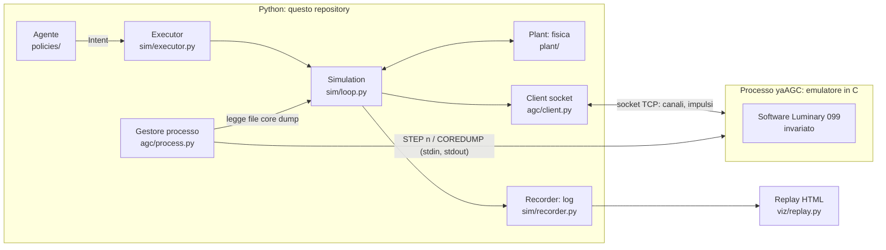
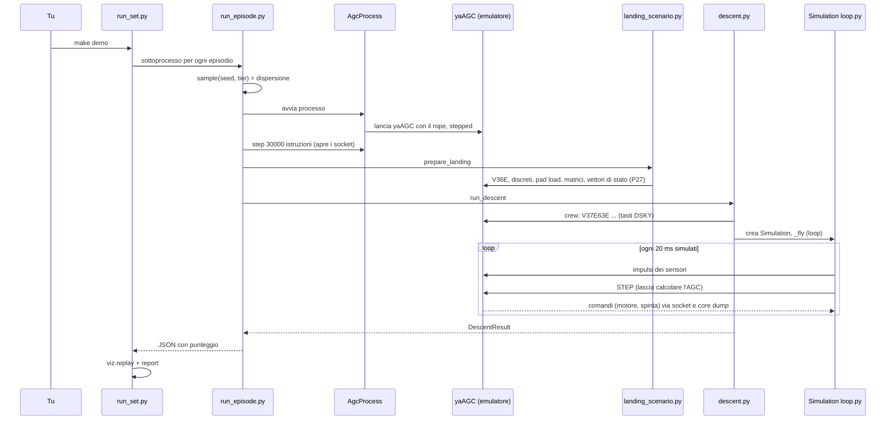
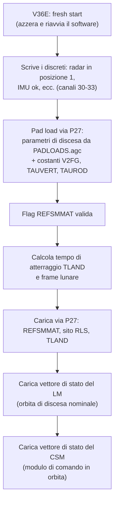
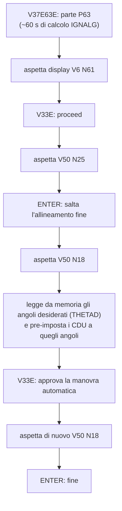
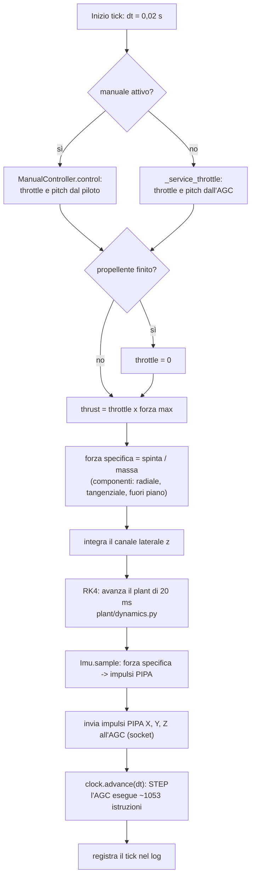
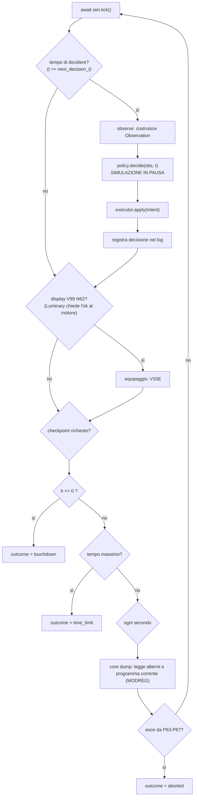
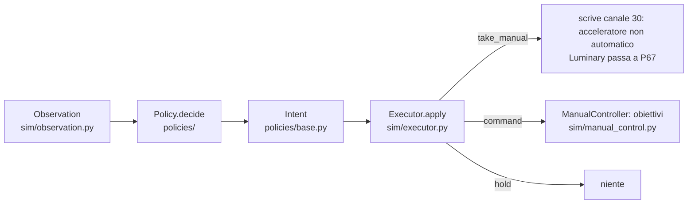

# README-simulator

Guida per studiare il codice offline. Niente è dato per scontato: prima il glossario, poi le
parti, poi il percorso di esecuzione passo passo (come "giocare a fare il computer"), poi ogni file.

Convenzioni: i nomi di file, funzioni e variabili restano in inglese (sono nel codice). Le unità
sono metri, secondi, chilogrammi, newton, salvo dove indicato.

---

## 1. Cos'è, in 10 righe

- Un programma **originale del 1969** (il software di volo del modulo lunare Apollo 11) gira
  **senza modifiche** dentro un emulatore.
- Noi scriviamo la **fisica del veicolo** (il "plant"): un modulo lunare che scende sulla Luna.
- Il software di volo crede di essere su un vero veicolo: gli mandiamo i **sensori finti**
  (accelerometri, angoli) e leggiamo i suoi **comandi** (accensione motore, spinta, direzione).
- Chiudendo questo anello, il software del 1969 **fa atterrare** il veicolo simulato.
- Sopra c'è un'interfaccia per un **agente** (un LLM in futuro): a intervalli riceve un'osservazione
  e può prendere il controllo manuale. Oggi ci sono solo due agenti non intelligenti.
- Tutto viene registrato in un log e mostrato in una pagina HTML (replay).
- La simulazione si può **mettere in pausa** mentre l'agente "pensa" (l'emulatore avanza solo se
  glielo diciamo noi).

---

## 2. Glossario (tutti gli acronimi usati)

| Termine | Significato |
|---|---|
| **LM** | Lunar Module, il modulo lunare (la parte che scende e atterra). |
| **AGC** | Apollo Guidance Computer, il computer di bordo del 1969. Parole da 15 bit, ~1 MHz. |
| **Luminary 099** | Nome del suo software di volo per Apollo 11. Il "rope" (corda): il programma già assemblato in un file binario. |
| **yaAGC** | Emulatore dell'AGC (programma in C, in `external/virtualagc`). Lo lanciamo come processo figlio. |
| **yaYUL** | Assemblatore: trasforma i sorgenti di Luminary (`.agc`) in binario. |
| **Listing** | File di testo prodotto da yaYUL con tutti i simboli e i loro indirizzi. Serve a trovare "dove sta la variabile X". |
| **Plant** | "L'impianto": la parte fisica simulata (veicolo, gravità, motore, sensori). |
| **DSKY** | Display e tastiera dell'AGC (DiSplay KeYboard). Ha 3 registri numerici R1, R2, R3, un numero di programma, un VERBO e un NOME. |
| **Verbo / Nome / Programma** | Comandi del DSKY. Verbo = azione (es. 37 = cambia programma), Nome = quale dato (es. N64 = dati di discesa), Programma = modalità di volo (es. P63). Si scrive `V37E63E`: verbo 37, ENTER, 63, ENTER. |
| **P63, P64, P65, P66, P67** | Programmi di discesa. **P63** frenata (dall'accensione del motore, ~15 km di quota, fino a ~8,7 km), **P64** avvicinamento (fino a ~90-130 m), **P65** fase finale verticale automatica, **P66** discesa con click manuali di velocità, **P67** acceleratore manuale. |
| **Canale (channel)** | Porta di ingresso/uscita dell'AGC, numerata in ottale. Es. canale 15 = tastiera. Alcuni bit dei canali 30-33 sono interruttori della cabina ("discreti"). |
| **Discreti** | Bit che dicono lo stato di interruttori/sensori (es. "acceleratore in automatico"). Nei canali 30-33 sono **invertiti**: 0 = presente. |
| **IMU** | Inertial Measurement Unit: piattaforma stabilizzata con giroscopi e accelerometri. |
| **PIPA** | Pulsed Integrating Pendulous Accelerometer: accelerometro che emette **impulsi**. Qui **1 impulso = 0,01 m/s** di variazione di velocità. |
| **CDU** | Coupling Data Unit: contatore che dice gli **angoli** dei giunti (gimbal) della piattaforma. 32768 impulsi = 360°. |
| **Stable member** | La piattaforma inerziale: mantiene fissa la sua orientazione nello spazio. Gli assi X, Y, Z dell'AGC sono quelli di questa piattaforma. |
| **REFSMMAT** | Matrice 3×3 che collega il sistema di riferimento "Luna" agli assi della piattaforma. |
| **DPS** | Descent Propulsion System: il motore di discesa. Regolabile 10–60% di spinta, poi salta al 92,5% (intervallo instabile in mezzo). 100% = 46,98 kN. |
| **RCS** | Reaction Control System: i piccoli getti per ruotare. **Non simulati** (l'assetto è perfetto). |
| **Throttle** | Acceleratore: frazione di spinta comandata. |
| **Registro THRUST** | Cella di memoria dell'AGC (indirizzo 055 ottale) in cui Luminary scrive di **quanto** cambiare la spinta (un incremento, non un livello). |
| **UNFC/2** | Variabile dell'AGC: vettore (3 numeri) con la **direzione** in cui vuole spingere, negli assi della piattaforma. |
| **Ecadr / erasable** | *Erasable* = memoria scrivibile dell'AGC (RAM), 8 banchi da 256 parole. *Ecadr* = indirizzo di una parola in essa (`banco*0400 + offset`, ottale). |
| **Core dump** | File di testo che yaAGC scrive con lo stato completo (canali, memoria, contatore di cicli). Da qui leggiamo variabili che non escono dal socket. |
| **Socket** | Connessione di rete locale (TCP) con cui parliamo a yaAGC: pacchetti da 4 byte, ognuno = "canale X ha valore Y". |
| **Stepped / realtime** | Due modi di far girare yaAGC. *Stepped*: avanza solo quando riceve il comando `STEP n` (pausabile). *Realtime*: gira libero a velocità reale. Oggi si usa solo stepped. |
| **P27 / V71 / V72 (uplink)** | P27 = programma di Luminary che accetta dati dal "suolo". V71 scrive fino a 18 parole consecutive, V72 fino a 9 coppie indirizzo-valore. È il **modo legittimo** con cui carichiamo dati nell'AGC (mai scriviamo la memoria di nascosto). |
| **Pad load** | Costanti di missione caricate prima del volo (massa, target di discesa, parametri...). Letti da `Luminary069/PADLOADS.agc`. |
| **State vector** | Posizione e velocità del veicolo che l'AGC crede vere, con un istante di tempo. |
| **Scaling "B-n"** | L'AGC usa frazioni: un numero salvato `v` vale `v × 2^n` unità (B-n = "binary point n"). Serve per convertire numeri veri ↔ parole dell'AGC (`agc/scaling.py`). |
| **Complemento a uno** | Formato dei numeri negativi dell'AGC (si invertono i bit). Parole da 15 bit; doppia precisione = 2 parole. |
| **PINC / MINC / PCDU / MCDU** | Comandi "incrementa/decrementa il contatore di 1", con cui i nostri sensori finti fanno avanzare i registri PIPA e CDU. |
| **TIG** | Time of IGnition, istante di accensione del motore. |
| **Allarme (alarm)** | Codice numerico che Luminary segnala su anomalie. Sono informativi, non fermano il volo. Esempi: 1410 = overflow di calcolo nella guida, 0401 = blocco cardanico. |
| **LR / radar** | Landing Radar: radar di atterraggio (misura la quota). Qui solo nell'osservazione dell'agente. |
| **ROD / LPD** | Rate Of Descent (click manuali di velocità di discesa) e Landing Point Designator (ridesignazione del sito). **Non disponibili** (vedi §10). |
| **Tick** | Un passo della simulazione: **20 ms** di tempo simulato (50 al secondo). |
| **Dispersione (dispersion)** | Differenza tra la realtà (plant) e ciò che l'AGC crede: spinta diversa, errore nello stato iniziale, meno propellente... |
| **Tier** | Livello di difficoltà 1, 2, 3 delle dispersioni. |
| **Coast** | Volo senza motore (solo gravità). |
| **Checkpoint** | Salvataggio dello stato completo (AGC + plant) per riprendere da lì. |

---

## 3. Mappa a grandi blocchi

Tre "mondi" che parlano tra loro:



Regola d'oro: **ogni volta che l'emulatore avanza, lo decidiamo noi**. Se non chiamiamo `STEP`, tutto è
fermo (simulazione e AGC). Per questo un agente lento non falsa nulla.

### Due canali di comunicazione verso yaAGC (importante)

| Canale | Cosa passa | File |
|---|---|---|
| **Socket TCP** (pacchetti da 4 byte) | Verso l'AGC: tasti DSKY, impulsi dei sensori, interruttori. Dall'AGC: display, comandi motore/getti. | `agc/client.py`, `agc/channels.py` |
| **stdin/stdout** del processo (debugger integrato) | `STEP <n>` (esegui n istruzioni) e `COREDUMP <file>` (salva lo stato). | `agc/process.py` |

Perché serve il core dump: la **spinta** che Luminary comanda sta in una cella di memoria e **non
viene mai trasmessa dal socket**. L'unico modo per leggerla senza modificare l'emulatore è leggere
il file di core dump (`agc/coredump.py`, `agc/guidance.py`).

---

## 4. Struttura del repository

```
Apollo-Agent/
├── README.md                    intro breve del progetto
├── README-simulator.md          questo file
├── APOLLO_AGENT_PLAN.md         piano di progetto + registro di tutte le scoperte tecniche
├── pyproject.toml               dipendenze (numpy), configurazione ruff/mypy/pytest
├── Makefile                     scorciatoie (vedi §9)
├── .pre-commit-config.yaml      controlli prima di ogni commit (ruff, ruff-format, mypy)
├── .python-version, uv.lock     versione Python e dipendenze bloccate (uv)
├── external/virtualagc/         sottomodulo git: emulatore + sorgenti Luminary. MAI modificato.
├── src/luminary_agent/          tutto il nostro codice (sezioni sotto)
│   ├── agc/                     "parlare con l'emulatore"
│   ├── plant/                   fisica e sensori
│   ├── sim/                     l'anello che collega tutto + scenario + registrazione
│   ├── policies/                gli agenti
│   ├── scenarios/               dispersioni casuali
│   ├── eval/                    lancio episodi, punteggio, report
│   └── viz/                     replay HTML
├── tests/unit/                  test veloci senza emulatore
├── tests/integration/           test contro l'emulatore vero
└── results/logs/                output degli episodi (ignorato da git)
```

Il pacchetto si chiama `luminary_agent`. `src/luminary_agent/__init__.py` contiene solo una
funzione `main()` che stampa "Hello": non è il punto di ingresso vero (vedi §5).

---

## 5. Da dove parte il codice

Non c'è un unico `main`. Ci sono quattro **punti di ingresso**, ognuno da lanciare con
`uv run python -m <modulo>`:

| Comando | Cosa fa |
|---|---|
| `luminary_agent.agc.build` | **Una volta sola**: scarica il sottomodulo, compila yaYUL e yaAGC (con cmake), assembla Luminary 099 e salva il listing. `make agc`. |
| `luminary_agent.eval.run_episode TIER SEED PORT WORKDIR --policy NOME --log FILE` | **Un episodio completo**: una discesa, stampa una riga JSON col punteggio. |
| `luminary_agent.eval.run_set --tiers ... --seeds ... --policy NOME` (o `--set frozen/dev`) | **Tanti episodi in parallelo**: lancia `run_episode` come processi separati, poi replay HTML e tabella riassuntiva. `make demo`. |
| `luminary_agent.viz.replay LOG OUT.html` | Trasforma un log in una pagina HTML. |
| `luminary_agent.eval.report CARTELLA` | Tabella riassuntiva di una cartella di risultati. |

Il percorso più importante da capire è quello di `run_episode` (sezione 6).

---

## 6. Percorso di esecuzione: "giocare a fare il computer"

Partiamo da `run_set`, che lancia più `run_episode`. Poi seguiamo **un** `run_episode`.

### 6.0 Visione d'insieme



### 6.1 `run_set.py` → `run_episode.py`

1. `run_set.__main__` legge gli argomenti. Costruisce la lista di coppie `(tier, seed)`: o da
   `--tiers/--seeds`, o da un set predefinito in `eval/sets.py`.
2. `main()` crea un semaforo con `--workers` posti e per ogni coppia chiama `one()`.
3. `one()` (se il file `tX_sY.json` non esiste già) lancia un sottoprocesso
   `python -m luminary_agent.eval.run_episode tier seed porta cartella-lavoro --log ... --policy ...`.
   Ogni episodio ha la **sua porta** (`--port-base + indice`): due emulatori sulla stessa porta
   si pestano.
4. Legge l'ultima riga di output del sottoprocesso (il JSON), la salva in `tX_sY.json`, e chiama
   `viz.replay.build()` per creare `tX_sY.html`.
5. Alla fine `report.summarize()` stampa la tabella per tier.

### 6.2 `run_episode.run()`, riga per riga

1. `disp = sample(seed, tier)` (`scenarios/dispersions.py`): estrae numeri casuali **ripetibili**
   (stesso seed = stessa dispersione) per spinta, massa, errori iniziali, propellente, radar.
2. `policy = POLICIES[nome]()` (`policies/scripted.py`): crea l'agente (`null` o `scripted`).
3. `sym = load_symbols(listing_path())`: legge il listing di yaYUL e costruisce la tabella
   **nome → indirizzo** (es. `"MODREG"` → indirizzo della variabile "modo corrente").
4. `AgcProcess(workdir, mode="stepped", port)` → `start()` lancia il **processo yaAGC**:
   `yaAGC --port=... --no-resume MAIN.agc.bin`. Con il debugger attivo si ferma al prompt `(agc) `.
5. `agc.step(30_000)`: fa girare 30 000 istruzioni. Serve perché yaAGC **apre i socket solo dopo
   aver eseguito almeno un passo**.
6. `AgcClient(port)`: connessione TCP. Parte un task in background che legge i pacchetti in arrivo e
   aggiorna `client.dsky` (cosa mostra il display) e `client.actuators` (motore acceso? getti?).
7. `prepare_landing(...)` (§6.3).
8. Se c'è un log: `Recorder(log, header)` scrive la prima riga del file.
9. `run_descent(...)` (§6.4–6.7) → un `DescentResult`.
10. `score(res, disp.dry_mass_kg)` (`eval/score.py`) → atterrato? sicuro? Stampa il JSON.

### 6.3 `prepare_landing` (`sim/landing_scenario.py`): portare l'AGC "a un attimo prima di P63"

Ogni passo è ciò che farebbero equipaggio o terra, sempre **attraverso Luminary**:



Dettagli:
- **Scenario nominale** (`DescentScenario`): orbita ellittica con punto più basso (perilune) a
  15,4 km di quota e velocità 1699,52 m/s; il sito di atterraggio è 440 015 m dopo quel punto;
  massa 15 000 kg. Il veicolo parte ~5 minuti prima del perilune.
- **Perché l'orbita ellittica**: una circolare farebbe fallire i calcoli di Luminary (allarme 1412).
- **Sistema di riferimento** (`sim/frames.py`, `plant/lunar_orientation.py`): il piano dell'orbita è
  scelto uguale all'equatore lunare. `LunarFrame.landing_refsmmat` costruisce la matrice per cui
  "asse X = su, asse Z = direzione di marcia, Y = Z×X" nel punto di atterraggio.
- **Importante**: l'AGC riceve lo stato **nominale**. La dispersione (§8) non gli viene mai detta:
  è la realtà a differire.
- Il vettore di stato del CSM serve perché P63 lo consulta; senza, allarme 1703.
- Tutti i dati passano per `agc/uplink.py` (`Updater.v71/v72`) che preme i tasti DSKY, e per
  `agc/loads.py` che raggruppa i dati in poche sessioni. Numeri convertiti con `agc/scaling.py`.

### 6.4 `run_descent` (`sim/descent.py`): equipaggio, coast, avvio dell'anello

1. **`start_p63`** (`sim/p63_crew.py`): l'equipaggio risponde ai messaggi di Luminary. Sequenza:



   Nota: non c'è dinamica d'assetto. I CDU vengono **impostati** direttamente all'assetto di
   accensione, così Luminary trova la manovra "già fatta". È un passo intermedio, non un veicolo che ruota.
   Ogni attesa (`wait_for_display`) fa avanzare l'AGC a blocchi da 20 000 istruzioni (~0,4 s AGC)
   guardando cosa mostra il display, finché compare il verbo/nome atteso.
2. **Coast**: durante tutto questo il plant non si è mosso (nessuno lo faceva avanzare). Si legge
   il tempo dell'AGC dal core dump e si fa "volare" il plant senza motore (`coast()`) per lo stesso
   tempo, applicando la dispersione allo stato iniziale.
3. Crea `SteppedClock` (`sim/clock.py`) e `Simulation` (`sim/loop.py`), poi entra in `_fly`.

### 6.5 Il cuore: `Simulation.tick()` (`sim/loop.py`), 50 volte al secondo simulato



Spiegato con un esempio numerico (motore a 15 000 N, massa 8 000 kg):
1. Accelerazione = 15 000 / 8 000 = **1,875 m/s²**. In 20 ms: **0,0375 m/s** di variazione di velocità.
2. Un impulso PIPA vale 0,01 m/s → escono **3 impulsi** (il resto 0,0075 m/s **si accumula** e
   viene emesso al tick dopo: `PulseCounter` conserva il resto). Ogni impulso è un pacchetto
   "incrementa il registro PIPA di 1" verso l'AGC.
3. Le forze sono ruotate negli **assi della piattaforma** (`sim/frames.py` + REFSMMAT): X, Y, Z
   ricevono impulsi diversi. Il PIPA-Z riceve la componente fuori dal piano (piccola).
4. `clock.advance(0.02)`: 0,02 s × 85 333 cicli/s = 1 707 cicli; a ~1,62 cicli per istruzione sono
   **~1 053 istruzioni**. Manda `STEP 2035` all'emulatore (il debugger vuole il numero in ottale: 1053 decimale = 2035 ottale) e aspetta il prompt.
   Ogni secondo ricalibra i cicli-per-istruzione leggendo il contatore di cicli dal core dump
   (evita che AGC e plant si sfasino; lo sfasamento residuo è `drift_s`, va tenuto vicino a 0).
5. Nel frattempo l'AGC ha **letto i PIPA**, sommato la velocità, e — ogni 2 secondi circa
   (ciclo di guida) — calcolato guida e comando motore.

### 6.6 Come si legge il comando dell'AGC: `_service_throttle`

L'AGC non dice "spingi a 15 000 N". Fa due cose che dobbiamo interpretare:

| Cosa dice l'AGC | Come lo leggiamo |
|---|---|
| "accendi/spegni il motore" | Bit 13/14 del canale 11: arriva dal socket, `agc/actuators.py` aggiorna `engine_on`. |
| "cambia la spinta di **N** unità" | Scrive N nel registro `THRUST` (memoria) e aggiorna `TTHROT` (un timbro con l'ora). **Non esce dal socket**: si legge dal core dump. |
| "spingi in questa direzione" | Scrive il vettore `UNFC/2` in memoria. Idem, dal core dump. |

Ogni **25 tick (0,5 s)**, o quando il motore si accende, `_service_throttle`:
1. fa un `COREDUMP` (~15 ms reali), lo legge con `agc/guidance.py` → `GuidanceSample`;
2. se il timbro `TTHROT` è **cambiato**, c'è un nuovo comando: lo passa a `ThrottleActuator.command`
   (`plant/throttle.py`), che somma gli incrementi e fa **scorrere** la spinta a 3 200 unità al
   secondo (1 unità = 12,533 N), tra minimo 10% e massimo 92,5%;
3. ricalcola sempre la **direzione**: converte `UNFC/2` dagli assi piattaforma al riferimento Luna
   (matrice REFSMMAT trasposta), poi sul piano dell'orbita; l'angolo di beccheggio `pitch` = angolo
   del vettore spinta rispetto alla verticale locale (`_apply_direction`). La parte fuori piano
   (`normal_fraction`) va al canale laterale.
4. Ipotesi semplificatrice dichiarata: **puntamento perfetto** (il veicolo ruota istantaneamente).

### 6.7 Il ciclo che avvolge il tick: `_fly` (`sim/descent.py`)

Ad ogni tick:



- **Allarmi**: raccolti dalla variabile `FAILREG`. Sono registrati, non fermano l'episodio.
- **Abort**: se Luminary lascia i programmi di atterraggio (torna a P00) dopo aver iniziato,
  l'episodio finisce come "aborted".
- **Decisioni** (agente): vedi §7.

### 6.7b Cronologia tipica di una discesa (dai log reali, tier 2 seed 0; tempi del plant)

| t (s) | Evento |
|---|---|
| 0 | Inizio del plant (orbita di discesa, ~17 km di quota) |
| ~58 | Fine dei preparativi dell'equipaggio, P63 attivo, l'anello parte |
| ~267 | Luminary chiede l'ok al motore (V99 N62), l'equipaggio risponde V33E, accensione al minimo |
| ~293 | Gas al massimo (43,4 kN, 92,5%) per la frenata |
| ~560 | Passaggio automatico P63 → P64 (quota ~8,7 km, velocità orizzontale ~860 m/s) |
| ~900 | Passaggio P64 → P65 (quota ~86 m) |
| ~910–1040 | Fase finale, tocco a ~0,7 m/s verticale |

### 6.8 Fine e punteggio

`DescentResult` contiene esito, tempo, stato finale, allarmi. `eval/score.py`:
- `landed` = esito touchdown.
- `safe` = landed **e** velocità verticale ≤ 3,0 m/s **e** velocità orizzontale
  **relativa alla superficie** ≤ 1,2 m/s.
- Perché "relativa alla superficie": la Luna ruota; a terra la superficie si muove di ~4,6 m/s
  nel riferimento inerziale (`plant/surface.py`).
- `site_error_m` = distanza dal sito di atterraggio del plant; `fuel_kg` = massa − massa a secco.

---

## 7. L'agente: osservazione, intenti, esecuzione



- **Observation** (cosa vede l'agente): tempo, modo (`auto`/`manual`), programma, verbo, nome, R1-R3
  del DSKY, allarmi, quota radar (o `None` senza aggancio), quota che Luminary crede di avere (letta
  dal DSKY, N63/N64 R3, in piedi), velocità verticale, velocità orizzontale rispetto alla
  superficie, spinta, massa, propellente. `to_text()` la scrive in testo per un LLM.
  *Non* vede la memoria dell'AGC né lo stato interno del plant.
- **Intent** (cosa può fare): `hold` (non fare nulla), `take_manual` (prendi acceleratore e
  assetto: irreversibile), `command(descent_rate_ms, horizontal_ms)` (obiettivi di velocità di
  discesa, limitati a [−6, 0] m/s, e orizzontale ±5 m/s).
- **Executor**: applica e **dice sempre l'esito** ("ok", "rejected: take_manual first",
  "ignored: already manual"...). Non indovina mai.
- **`take_manual`** = scrive i canali 30-33 con il bit "acceleratore automatico" a zero. Il
  monitor interno di Luminary (R13) lo vede, passa a **P67** e smette di comandare il motore. Da lì
  throttle e pitch vengono da `ManualController.control`.
- **ManualController**: legge lo stato **vero** (occhi dell'equipaggio) e calcola: velocità
  verticale obiettivo (una tabella con la quota, oppure quella comandata), annulla la velocità
  orizzontale rispetto alla superficie, resta nei limiti di throttle (10–60%) e di inclinazione
  (0,6 rad).
- **Cadenza**: l'agente viene chiamato al massimo ogni 0,5 s simulati o quando scade
  `valid_until_s` del suo ultimo intento. Mentre `decide()` gira **nulla avanza**; il tempo reale
  impiegato è registrato (`latency_s`).
- **NullAgent**: sempre `hold`. **ScriptedAgent**: `take_manual` quando la quota radar ≤ 150 m o
  Luminary è in P65, poi lascia fare al controllore.

---

## 8. Dispersioni e livelli di difficoltà (`scenarios/dispersions.py`)

`sample(seed, tier)` → `Dispersion` (immutabile):

| Campo | Significato |
|---|---|
| `thrust_scale` | Il motore spinge x% più/meno del previsto |
| `mass_scale` | Massa reale diversa |
| `dh0_m`, `dvt0_ms`, `dvh0_ms` | Errore nella quota / velocità tangenziale / verticale **iniziali del plant** (l'AGC non lo sa) |
| `propellant_scale` | Propellente utilizzabile ridotto → il motore si spegne a `dry_mass_kg` |
| `radar` | Errore sistematico e (solo tier 3) fascia di quote senza aggancio |

| Tier | Spinta | Errore quota | Errore velocità | Meno propellente | Radar |
|---|---|---|---|---|---|
| 1 | ±0,5% | 0 | 0,005 m/s | fino 2% | bias fino a ±1% |
| 2 | ±1,5% | 10 m | 0,02 m/s | fino 5% | bias fino a ±2% |
| 3 | ±3% | 100 m | 0,3 m/s | fino 9% | bias fino a ±3% + fascia senza aggancio |

In più la massa reale differisce dal nominale di ±1%, ±3%, ±5% (tier 1, 2, 3).

Perché queste scale: senza aggiornamento del radar verso l'AGC, un errore di velocità iniziale
cresce di circa **700 m di posizione per ogni m/s** durante la discesa.
Tier 3 = errore che **Luminary non può vedere**: da solo si schianta; un equipaggio che legge il
radar atterra.

Le dispersioni **non** cambiano cosa l'AGC crede. Cambiano la realtà.

---

## 9. Registrazione e replay

### Formato del log (`sim/recorder.py`)
File `.jsonl.gz` (una riga JSON per riga, compresso). Tre tipi di riga:
- **header** (prima riga): policy, tier, seed, dispersione, formato.
- **tick** (una per ogni 20 ms): `t, h_m` (quota), `x_m` (distanza percorsa), `z_m` (laterale),
  `hdot_ms` (velocità verticale), `vt_ms` (velocità tangenziale inerziale), `mass_kg`, `thrust_n`,
  `mode`, `pitch_deg`, `pipa_pulses`, `dsky{prog, verb, noun, r1, r2, r3}`, `engine_on`, `jets`,
  `throttle_strobes`, `clock_drift_s`.
- **decision** (una per decisione): `t`, `obs`, `intent{kind, params}`, `applied`, `latency_s`.

`read_episode` restituisce i tick; `read_decisions` le decisioni.

### Replay (`viz/replay.py` + `viz/replay.html`)
Un solo file HTML, senza dipendenze. `replay.py` legge il log, riduce a 10 Hz, calcola la velocità
orizzontale relativa alla superficie, comprime le decisioni ripetute, e sostituisce i segnaposto
`__TITLE__`, `__FIELDS__`, `__DATA__`, `__DEC__`, `__ALT__`, `__HZ__` nel modello HTML.
Nella pagina: vista laterale (LM, fiamma, vettore velocità, griglia delle quote; lo zoom segue la
quota), pannello DSKY con badge AUTO/MANUAL e allarmi, quota radar e quota AGC, strumenti,
play/pausa, velocità 0,5×–20×, cursore, log delle decisioni cliccabile. Il terreno è solo
estetico: la linea a quota 0 è il suolo vero.

### File di risultato per episodio (`results/logs/<cartella>/`)
- `tX_sY.json`: punteggio + dispersione + esito e note.
- `tX_sY.jsonl.gz`: log completo.
- `tX_sY.html`: replay.
- `work_tX_sY/`: cartella di lavoro dell'emulatore (`snapshot.core` ecc.).

---

## 10. Cosa NON c'è (semplificazioni da ricordare)

- **Assetto**: perfetto e istantaneo, nessuna dinamica di rotazione, nessun getto RCS.
- **Rotazione lunare**: non applicata al plant (solo al *giudizio* dell'atterraggio).
- **Radar verso l'AGC**: assente (l'emulatore, nella versione a socket, non ha il canale radar).
  Il radar esiste solo nell'osservazione.
- **P66 e ridesignazione del sito**: bloccati. I click ROD non arrivano via socket, e mancano i
  valori originali di alcune costanti dell'Apollo 11 (`RODSCALE`, `LAG/TAU`, `MAXFORCE`, `MINFORCE`).
- **Abort verso l'orbita**: non c'è un modello di ascesa.
- **Pad load**: presi da Luminary 069 (Apollo 10), non 099.
- **Modo realtime**: esiste `RealtimeClock` ma la discesa completa non è guidata in quel modo.
- **~1 km** di scarto nella matrice di orientazione lunare rispetto al sito che vede l'AGC
  (causa non chiarita) e ~300–700 m di scarto sul sito a fine discesa.
- **Makefile**: `make run`, `make eval`, `make reproduce` puntano a moduli che **non esistono**.
  Funzionano: `setup`, `agc`, `test`, `lint`, `demo`.

---

## 11. Ogni file, uno per uno

### 11.1 `src/luminary_agent/agc/` — parlare con l'emulatore

| File | Cosa fa | Cose principali |
|---|---|---|
| `build.py` | Compila yaYUL e yaAGC (cmake) dal sottomodulo, assembla Luminary 099, salva il listing. | `ensure_submodule`, `build_binaries`, `assemble`, `listing_path`, `yaagc_path`, `main` |
| `process.py` | Lancia e pilota il **processo** yaAGC. In stepped: `STEP n` e `COREDUMP` via stdin/stdout. | `AgcProcess`: `start`, `step`, `coredump`, `save_state`, `close`; opzione `resume_from` per riprendere da un core dump |
| `client.py` | Connessione TCP a yaAGC. Task in background che legge i pacchetti e aggiorna `dsky` e `actuators`. Scrive canali, tasti, impulsi. | `AgcClient`: `write_channel(s)`, `press_key`, `send_pipa_pulses`, `send_cdu_pulses` |
| `channels.py` | Codifica/decodifica dei pacchetti da 4 byte: byte0 `00UCCCCC`, byte1 `01cccVVV`, byte2 `10VVVVVV`, byte3 `11VVVVVV` (canale a 8 bit, valore a 15 bit, bit "u"). | `encode_packet`, `decode_packet` |
| `registers.py` | Come far avanzare i contatori PIPA/CDU: pacchetto sul canale `0x80 | registro` con tipo di incremento (PINC 0, PCDU 1, MINC 2, MCDU 3; CDU veloce 0o21/0o23). | `pipa_pulse_packets`, `cdu_pulse_packets`, costanti `REG_PIPAX...` |
| `dsky.py` | Tasti del DSKY (codici per il canale 15) e decodifica del display a 7 segmenti che l'AGC manda sul canale 10. | `KEYCODE`, `DskyState` (`r1, r2, r3, program_number, verb_number, noun_number`) |
| `stepped_dsky.py` | Premere tasti su un AGC **stepped**: dopo ogni tasto fa avanzare l'AGC (un tasto sovrascriverebbe il precedente). Distingue ottale/decimale. | `SteppedDsky`: `key`, `enter`, `enter_octal`, `enter_decimal`, `verb`, `fresh_start` |
| `actuators.py` | Decodifica di ciò che l'AGC comanda: getti (canali 5, 6), motore acceso/spento (canale 11), impulso di strobe della spinta (canale 14). | `ActuatorState.apply_channel` |
| `coredump.py` | Legge il file core dump: 512 righe di canali, 8×256 parole di memoria, contatore cicli. | `parse_core_dump`, `CoreDump` (`ecadr_words`, `clock_cs`, `cycle_counter`), `CoreDumpPoller` (per il realtime), `THRUST_REGISTER`, `AGC_CYCLES_PER_SECOND = 85333` |
| `symbols.py` | Dal listing: nome simbolo → indirizzo. | `load_symbols`, `SymbolTable.ecadr / constant / erasable_address` |
| `scaling.py` | Numeri AGC ↔ numeri veri: singola/doppia precisione, complemento a uno, scaling B-n. | `sp_*`, `dp_*`, `dp_from_value`, `dp_to_value` |
| `uplink.py` | Scrive nella memoria dell'AGC **via P27** (tasti V71/V72 e verifica V33E). Valida gli argomenti. | `Updater.v71`, `Updater.v72`, `UpdateError` |
| `loads.py` | Da una mappa {indirizzo: parola} costruisce le sessioni P27 più corte, poi le esegue. | `plan_loads`, `run_plan`, `padload_words` |
| `padloads.py` | Legge il catalogo pad load da `Luminary069/PADLOADS.agc` (direttive assembler: `2DEC`, `1DEC`, `OCT`...). | `load_padloads`, `parse_padloads`, `PadLoad` |
| `state_vector.py` | Vettore di stato (posizione, velocità, tempo) → parole AGC; carica LM e CSM via P27. | `StateVector`, `load_lm_state_vector`, `load_csm_state_vector` |
| `landing_setup.py` | Dati richiesti da P63 oltre ai pad load: REFSMMAT, sito RLS, TLAND, bit di flag. | `refsmmat_words`, `rls_words`, `tland_words`, `set_flag_bit` |
| `cdu.py` | Angoli dei giunti: conversioni, lettura degli angoli desiderati da Luminary (THETAD), pre-impostazione dei registri CDU. | `desired_gimbal_counts`, `cdu_counts`, `seed_cdus` |
| `guidance.py` | Legge dal core dump **cosa vuole la guida**: incremento di spinta, direzione, timbro. | `GuidanceSample`, `read_guidance` |

### 11.2 `src/luminary_agent/plant/` — fisica e sensori

| File | Cosa fa | Cose principali |
|---|---|---|
| `dynamics.py` | Modello 3 gradi di libertà **polare** sulla Luna sferica: stato (quota `h`, distanza `x`, velocità verticale, velocità tangenziale, massa). Integra con Runge-Kutta 4° ordine, 50 Hz. Include lo sgravio centrifugo (a 1,7 km/s la forza centrifuga quasi annulla la gravità). | `PlanarState`, `Control(throttle, pitch)`, `derivative`, `step`, `DT_S = 0.02` |
| `gravity.py` | Gravità 1/r² con raggio della Luna di Luminary (1 738 090 m) e μ = 4,9028e12. | `g(altitude)` |
| `propulsion.py` | Motore DPS: limiti di throttle (10%, 60%, 92,5%), forza (100% = 46,98 kN), consumo (impulso specifico 311 s). Costante 12,533 N per unità di spinta dell'AGC. | `resolve_throttle`, `DescentEngine.thrust_and_mdot` |
| `throttle.py` | Attuatore che **integra gli incrementi** di spinta comandati dall'AGC e li fa scorrere a velocità limitata; gestisce accensione. | `ThrottleActuator` (`command`, `step`, `set_engine`) |
| `sensors.py` | Modello IMU: forza specifica → impulsi PIPA (0,01 m/s per impulso, il resto viene accumulato); angoli → impulsi CDU. | `PulseCounter`, `Imu.sample` |
| `discretes.py` | Interruttori di cabina sui canali 30-33 (con logica invertita): acceleratore automatico, IMU ok, modo assetto, radar... | `Discretes.channel_words()` |
| `orbit.py` | Orbita kepleriana analitica per costruire lo stato iniziale coerente (ellisse di discesa). | `DescentOrbit.with_perilune_speed`, `state_at`, `time_to_perilune_s` |
| `lunar_orientation.py` | Porta di `MOONMX`: come Luminary calcola l'orientazione della Luna nel tempo (rotazione, nodo, inclinazione). | `moon_matrix`, `rp_to_r`, `r_to_rp` |
| `surface.py` | Velocità **relativa alla superficie** (che ruota) e scarto sul sito. | `horizontal_speed_relative_to_surface`, `downrange_error_m` |
| `radar.py` | Quota radar vista dall'agente: bias, rumore, fascia senza aggancio. | `Radar.altitude` |

### 11.3 `src/luminary_agent/sim/` — l'anello, lo scenario, la registrazione

| File | Cosa fa | Cose principali |
|---|---|---|
| `loop.py` | **Il tick** (§6.5), gestione motore/direzione (§6.6), canale laterale, registrazione. | `Simulation` (`tick`, `run`, `advance_instructions`), `PipaAxes`, `stepped_guidance_reader` |
| `descent.py` | Discesa completa: crew, coast, `_fly`, checkpoint/ripresa, osservazione, riepilogo. | `run_descent`, `_fly`, `observe`, `save_checkpoint`, `resume_descent`, `coast`, `summarize`, `DescentResult` |
| `landing_scenario.py` | Prepara un AGC pronto per P63 (§6.3) e definisce lo scenario nominale. | `DescentScenario`, `LandingSetup`, `prepare_landing` |
| `p63_crew.py` | Le risposte dell'equipaggio ai messaggi di P63 (§6.4). | `start_p63`, `wait_for_display`, `CrewProcedureError` |
| `frames.py` | Sistemi di riferimento: dal piano del plant allo spazio 3D dell'AGC; matrice REFSMMAT di atterraggio; vettori di stato; algebra dei vettori. | `LunarFrame`, `dot`, `cross`, `mat_vec` |
| `clock.py` | Orologi. `SteppedClock`: avanza l'AGC di quante istruzioni servono per coprire `dt`, ricalibrando. `RealtimeClock`: dorme fino al tempo reale. | `SimClock` (protocollo), `SteppedClock`, `RealtimeClock` |
| `observation.py` | Cosa può vedere l'agente. | `Observation` |
| `executor.py` | Applica gli intenti e riporta l'esito. | `Executor` |
| `manual_control.py` | Il "pilota manuale": obiettivi → throttle e pitch. | `ManualController` |
| `recorder.py` | Scrive/legge il log compresso (header, tick, decisioni). | `Recorder`, `read_episode`, `read_decisions` |

### 11.4 `policies/`, `scenarios/`, `eval/`, `viz/`

| File | Cosa fa |
|---|---|
| `policies/base.py` | Definisce `Intent`, le funzioni `hold`, `take_manual`, `command`, e il **protocollo `Policy`** (`decide(obs, t)`, `reset()`, `name`) che ogni agente deve rispettare. |
| `policies/scripted.py` | `NullAgent` (mai interviene), `ScriptedAgent` (regola fissa), dizionario `POLICIES`. **Qui si registra un nuovo agente.** |
| `policies/llm/prompts/` | Cartella vuota, prevista per i prompt dell'LLM. |
| `scenarios/dispersions.py` | `Dispersion` e `sample(seed, tier)` (§8). |
| `eval/run_episode.py` | Un episodio con punteggio (§6.2). |
| `eval/run_set.py` | Molti episodi in parallelo, replay e tabella. |
| `eval/score.py` | `score()` → `Score(landed, safe, vertical_ms, horizontal_ms, site_error_m, fuel_kg)`. |
| `eval/sets.py` | Set congelato (tier 1-3 × seed 100-119 = 60 episodi) e di sviluppo (seed 0-4 = 15). Non ritoccare il congelato. |
| `eval/report.py` | Tabella per tier: quanti sicuri, mediane. |
| `viz/replay.py`, `viz/replay.html` | Replay (§9). |

### 11.5 Test

**Unitari** (`tests/unit/`, ~0,8 s, senza emulatore):

| File | Verifica |
|---|---|
| `test_channels.py` | codifica/decodifica dei pacchetti |
| `test_registers.py` | pacchetti di incremento PIPA/CDU |
| `test_scaling.py` | conversioni numeri AGC, contro valori di riferimento dell'assemblatore |
| `test_dsky.py` | decodifica display 7 segmenti e tasti |
| `test_actuators.py` | decodifica di getti/motore/strobe |
| `test_coredump.py` | lettura del core dump |
| `test_symbols.py` | tabella simboli dal listing |
| `test_uplink_validation.py` | controlli degli argomenti di V71/V72 |
| `test_loads.py` | raggruppamento in sessioni P27 |
| `test_padloads.py` | parser dei pad load |
| `test_state_vector.py` | conversione dei vettori di stato |
| `test_cdu.py` | conversioni angoli e conteggi |
| `test_discretes.py` | mappa bit dei canali 30-33 |
| `test_dynamics.py` | fisica: casi analitici (caduta libera, orbita circolare...) |
| `test_gravity.py`, `test_propulsion.py` | costanti e limiti motore |
| `test_throttle.py` | attuatore di spinta |
| `test_sensors.py` | quantizzazione impulsi PIPA |
| `test_orbit.py`, `test_lunar_orientation.py`, `test_frames.py`, `test_surface.py` | geometria e orientazione |
| `test_loop_throttle.py` | comportamento del loop con l'attuatore |
| `test_clock.py` | orologi |
| `test_p63_crew.py` | sequenza di tasti dell'equipaggio |
| `test_recorder.py` | log |
| `test_policy_base.py`, `test_agent_interface.py` | intenti, agenti, esecutore, osservazione |
| `test_manual_control.py` | il controllore atterra da uno stato iniziale, senza AGC |
| `test_dispersions.py`, `test_radar.py` | dispersioni riproducibili, limiti, radar |
| `test_score.py`, `test_eval_sets.py` | punteggio, set, report |

**Di integrazione** (`tests/integration/`, richiedono yaAGC compilato):

| File | Verifica |
|---|---|
| `test_gate0_mission_timer.py` | l'emulatore gira e il timer avanza |
| `test_stepped_mode.py` | pausa, ripresa, tasti in modo stepped |
| `test_coredump_against_real_yaagc.py` | il core dump reale ha il formato atteso |
| `test_pipa_pulses_against_real_yaagc.py` | gli impulsi PIPA arrivano nei registri |
| `test_discretes_against_real_yaagc.py` | i discreti sono letti da Luminary |
| `test_uplink_p27.py`, `test_padloads_p27.py`, `test_state_vector_p27.py` | i caricamenti via P27 arrivano davvero |
| `test_sim_loop_coasting.py` | il loop in volo senza motore |

---

## 12. Come studiare, in ordine consigliato

1. Questo file, §1–§3.
2. `agc/channels.py` → `agc/client.py` → `agc/process.py` (come si parla all'emulatore).
3. `plant/dynamics.py` → `plant/sensors.py` (fisica e impulsi).
4. `sim/loop.py` (il tick) → `sim/clock.py`.
5. `sim/landing_scenario.py` → `agc/uplink.py` → `sim/p63_crew.py` (preparare l'AGC).
6. `sim/descent.py` (`_fly`) → `sim/executor.py` → `policies/`.
7. `eval/run_episode.py` → `eval/run_set.py` → `viz/replay.py`.
8. `APOLLO_AGENT_PLAN.md` per il "perché" di ogni scelta e le scoperte tecniche.

Per **vedere** il codice fare qualcosa: apri un `results/logs/<cartella>/tX_sY.html`.
