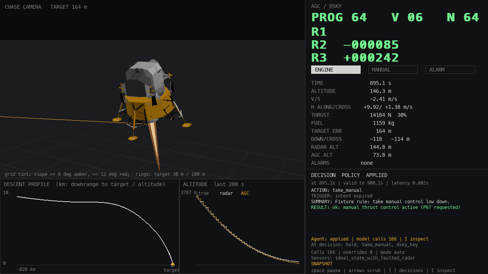
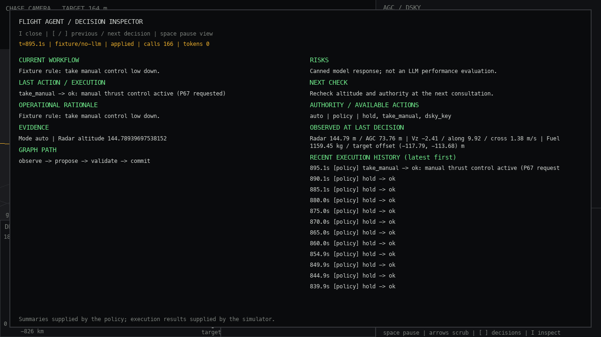
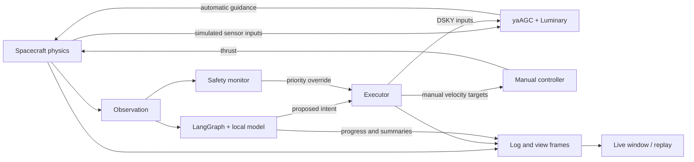
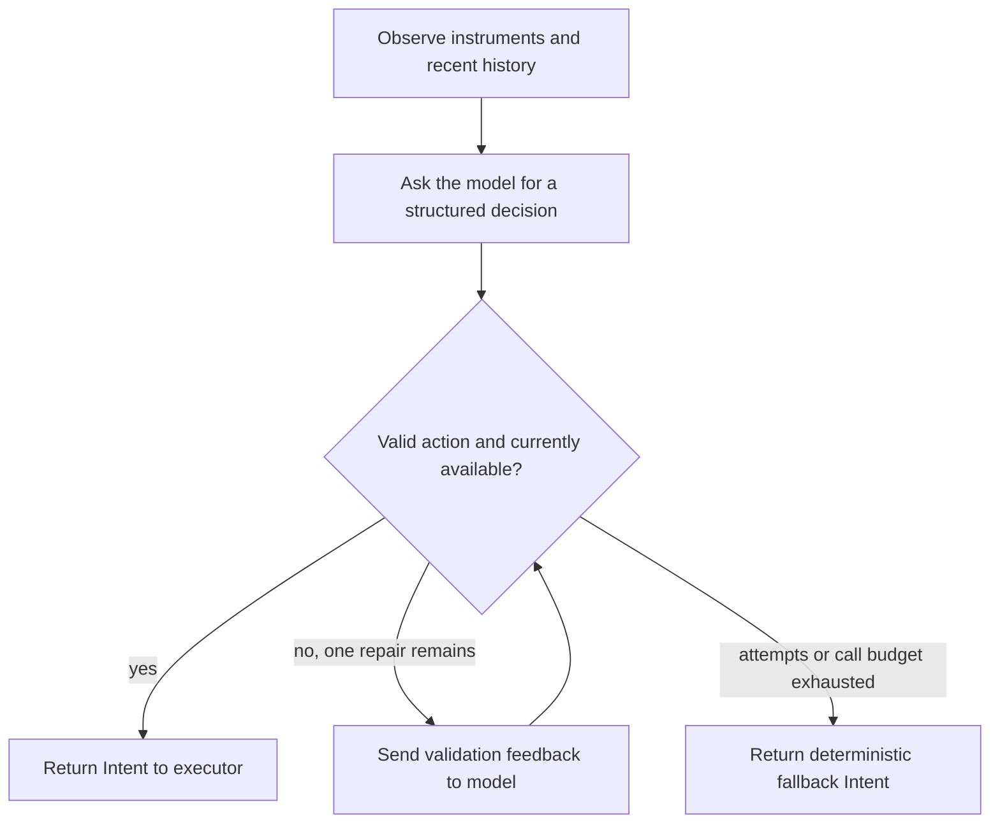

# Lunar Agent Module

**A LangGraph flight supervisor for an Apollo Lunar Module simulation.**

An agentic AI project demonstrating orchestration, validated action execution, failure recovery,
observability and evaluation in a stateful control environment.

The original **Luminary 099** flight software runs inside an Apollo Guidance Computer (AGC)
emulator. A Python simulator supplies the spacecraft physics. A **LangGraph agent** reads flight
observations, decides whether to intervene, and sends validated requests to the simulator.
A native window lets you watch the lander and inspect what the agent proposed and what happened.



The agent acts as a supervisory pilot. The AGC supplies automatic guidance; after manual takeover,
a deterministic controller follows the agent's velocity targets. The language model does not
calculate thrust on every physics step.

Repository name: `lunar-agent-module`. The Python package is `luminary_agent`, and its terminal command
is `luminary`.

## Engineering focus

The project explores how to connect model decisions to a running system with explicit control
boundaries and measurable outcomes. Its core engineering contributions are:

- **Agent orchestration:** a LangGraph workflow for observation, structured proposals, validation,
  bounded repair and deterministic fallback, with local inference through Ollama.
- **Controlled execution:** capability-aware actions, an executor that owns spacecraft mutations,
  and a deterministic safety monitor that can override policy decisions.
- **System integration:** a Python flight simulator coupled to the upstream yaAGC emulator running
  original Luminary software, with synchronized stepping and repeatable scenario generation.
- **Observability:** live decision inspection, execution feedback, structured logs and offline replay.
- **Evaluation:** baseline policies, scenario sets, integration tests and separate touchdown/mission
  criteria so behavior can be assessed beyond the model's explanation.

**Current evidence:** the implementation checkpoint passed 345 unit tests and 19 real-AGC integration
tests. The end-to-end agent test uses controlled model responses; real local-model landing performance
still needs evaluation. The system's implementation and test coverage are established separately from
any claim that an LLM is a successful lunar pilot.

For a technical overview, start with [how a flight works](#how-a-flight-works).
To see the application, use the local launcher below.

## Start here

| What you want | Where to go |
|---|---|
| Watch a local model fly, with the interface visible | [Run the local agent](#run-the-local-agent) |
| Set up a new checkout | [First-time setup](#first-time-setup) |
| Understand the screen and its controls | [Watch and inspect a flight](#watch-and-inspect-a-flight) |
| Understand the agent, AGC and simulator | [How a flight works](#how-a-flight-works) |
| Find the code to read or change | [Code guide](#code-guide) |
| Change the model or other settings | [Configuration](#configuration) |
| Run tests or compare policies | [Tests and evaluation](#tests-and-evaluation) |
| Read results, replay a flight, or diagnose problems | [Logs and scores](#logs-and-scores) · [Troubleshooting](#troubleshooting) |

## Run the local agent

**For an already prepared checkout**, open Terminal in the repository directory and run:

```sh
./launch-agent.sh
```

This opens the simulation window and uses **Ollama with `llama3.2:3b` on your computer**.
No API key is required. Ollama must be running and that model must be installed.
Press **I** in the window to open the agent inspector.

[launch-agent.sh](launch-agent.sh) is an executable **shell launcher**.
It changes to the project directory, allows 60 seconds per model request, and starts the flight.
The agent implementation is in [policies/agent.py](src/luminary_agent/policies/agent.py).

The equivalent command, written out so you can change it, is:

```sh
LUMINARY_REQUEST_TIMEOUT_S=60 uv run --extra agent luminary fly --policy llm --provider ollama --model llama3.2:3b --base-url http://127.0.0.1:11434 --tier 1
```

| Part | Meaning |
|---|---|
| `uv run --extra agent` | Run in the project's Python environment with the optional agent libraries installed. |
| `luminary fly` | Start one landing episode and open its window. |
| `--policy llm` | Use the LangGraph agent to make supervisory decisions. |
| `--provider ollama` | Send model requests to Ollama. |
| `--model llama3.2:3b` | Select this installed model. Replace it with another model name from `ollama list`. |
| `--base-url http://127.0.0.1:11434` | Use the Ollama server on this computer. |
| `--tier 1` | Start with the mildest scenario dispersions. The default seed is `0`. |
| `LUMINARY_REQUEST_TIMEOUT_S=60` | Give each inference request up to 60 seconds of wall time. |

You do not need to configure the other options for a first flight. `llama3.2:3b` is the starter
model selected in this launcher, not a demonstrated best pilot. Local-model landing performance
has not yet been established by evaluation.

### Check Ollama

```sh
ollama list
```

If the server is unavailable, open the Ollama app or run the following in a separate Terminal
and leave it running:

```sh
ollama serve
```

If `llama3.2:3b` is absent from the list, download it once:

```sh
ollama pull llama3.2:3b
```

These are standard [Ollama CLI commands](https://docs.ollama.com/cli). Model downloads need internet
access; the configured local flight uses the local server. Models must support the structured
responses expected by the adapter. An installed model is not automatically a reliable flight policy.

### Watch a flight without a language model

To check the simulator and window independently of Ollama:

```sh
uv run luminary fly --tier 1 --seed 0 --policy scripted
```

There are three policies:

| Policy | Who makes supervisory decisions? | Requires a model? |
|---|---|---|
| `null` | Always requests `hold`; leaves guidance to the AGC unless safety intervenes. | No |
| `scripted` | A fixed rule takes manual control at radar altitude ≤150 m or in AGC program P65, then keeps the default controller schedule. | No |
| `llm` | The selected model proposes actions through the LangGraph workflow. | Yes |

**Safety is enabled for all three.** A `null` flight is therefore not necessarily an entirely
unassisted AGC flight. `--no-safety` is available for deliberate comparison experiments.

## First-time setup

Skip this section if the emulator and Python environment are already prepared.
Commands below run from the repository root; no manual virtual-environment activation is needed.

| Requirement | Used for |
|---|---|
| Git | Fetching this repository and the VirtualAGC submodule. |
| [uv](https://docs.astral.sh/uv/) and Python 3.12 | Installing the locked Python environment; the Python version is declared in `.python-version`. |
| CMake ≥3.27 and a C/C++ toolchain | Building the AGC emulator and assembler. On macOS, use Xcode Command Line Tools. |
| Ollama | Serving a local model for `--policy llm --provider ollama`. |
| A desktop display | Opening the pygame window; tests and headless runs can work without one. |

1. Clone the repository, including its pinned emulator:

   ```sh
   git clone --recursive https://github.com/GiulioRusso/lunar-agent-module.git
   cd lunar-agent-module
   ```

2. Install Python dependencies, including the agent libraries:

   ```sh
   uv sync --extra agent
   ```

3. Build the emulator and assemble the Apollo program:

   ```sh
   make agc
   ```

4. Check Ollama and launch the flight:

   ```sh
   ollama list
   ./launch-agent.sh
   ```

`external/virtualagc` is a **Git submodule**: a pinned checkout of another project containing the
emulator, assembler and Apollo source code. If it is empty after cloning, run
`git submodule update --init --recursive`. The build also handles fetching the submodule.

`make agc` applies the project's emulator patches to a build-cache worktree and assembles the
Luminary program. It does not implement the AGC in Python or rewrite the Apollo flight software.
Generated build files live under `results/cache/agc/`. The first flight also creates a reusable
pre-ignition AGC snapshot; startup can take longer while that is being built.

For development, `make setup` installs the base environment and Git pre-commit hooks.
Agent commands explicitly use `--extra agent`; `make test` and `make lint` include the agent
requirements where needed.

## Watch and inspect a flight

The normal view combines the lander scene, flight plots, AGC display and latest decision.
The AGC's display/keyboard is called the **DSKY**. Its `PROG`, `VERB` and `NOUN` fields identify
the running program and the displayed operation/data.

Press **I** to inspect:

- **Current workflow:** whether the agent is observing, requesting a response, validating, repairing,
  or falling back. The simulator publishes progress while waiting for inference.
- **Last action and execution:** what was requested and whether the executor applied, submitted,
  rejected or failed it. A submitted DSKY key does not prove a maneuver completed.
- **Rationale, evidence, risks and next check:** concise summaries supplied by the policy.
- **Observed at last decision:** simulator-supplied readings to compare against those summaries.
- **Graph path and usage:** the workflow steps, cumulative model calls and reported tokens.
- **Recent execution history:** previous actions, including policy, fallback and safety sources.

A convincing explanation is not proof that an action was correct. Check the actual execution
result, trajectory and final score. The inspector displays operational summaries, not private
model chain-of-thought. Full records remain in the log when screen text is abbreviated.

| Key | Effect |
|---|---|
| `I` | Open or close the inspector. |
| `[` / `]` | Previous / next decision; pauses playback and leaves live-follow mode. |
| `Space` | Pause or resume playback of the view. |
| Left / Right | Scrub 5 simulated seconds; hold Shift for 30 seconds. |
| Up / Down | Change playback speed. |
| Home / End | Jump to the first / latest available frame. |
| `1` / `2` / `3` | Chase / ground / top-down camera. |
| Esc / `Q` | Close the window. |

**Two different pauses matter:**

- While the model decides, **simulated time stops**: neither the spacecraft nor the AGC advances.
  The interface stays responsive and can show inference progress.
- When you pause the **viewer**, the flight continues in its separate process. You are inspecting
  previously received frames. Closing the window also leaves the episode running; the terminal
  waits for its result.

After the flight finishes, the window switches to replay. The CLI prints the outcome and saved log
path. Local inference may make a flight much longer than a baseline run: many decisions each incur
model latency, even though the simulated duration does not change for that reason alone.

An example of the inspector from a real-AGC integration flight is shown below. The model is
labelled `fixture/no-llm`: its responses were controlled by the test, not generated by an LLM.



## How a flight works

### The responsibilities

| Component | Job | Runs when |
|---|---|---|
| Physics model, often called the **plant** | Update position, velocity, fuel and simulated sensors. | Every 20 ms of simulated time. |
| AGC emulator running Luminary | Execute the Apollo navigation and automatic landing guidance. | In step with the physics. |
| Policy / LangGraph agent | Assess observations and request an intervention or `hold`. | On events, intent expiry, or the 5-second heartbeat. |
| Executor | Validate requests, enforce control ownership and report what was actually done. | When a policy or safety action is applied. |
| Manual controller | Convert velocity targets into bounded thrust commands after takeover. | Every physics step in manual mode. |
| Safety monitor | Override control during observed envelope violations. | Every simulation tick. |
| Viewer and recorder | Display the flight and save evidence for replay/evaluation. | Throughout the episode. |



### From the launch command to touchdown

1. **CLI:** `__main__.py` parses the command, checks agent configuration and opens the viewer.
   With a window, a separate Python process runs the descent so rendering cannot hold up its loop.
2. **Episode setup:** `eval/run_episode.py` samples the scenario, creates the policy, safety monitor
   and surface, and starts/resumes the AGC through `sim/snapshot.py`.
3. **Flight loop:** `sim/descent.py` calls `Simulation.tick()` in `sim/loop.py`. Each tick selects
   control, integrates physics, sends sensor inputs, advances the AGC and records the result.
   Automatic guidance values are sampled at a slower interval than the physics ticks.
4. **Supervision:** the loop builds an `Observation`, checks safety, and asks the policy when a
   decision is due. An active safety intervention blocks policy consultations until recovery.
5. **Execution:** the policy returns an `Intent`; the executor applies or rejects it. The next
   observation contains the actual previous execution result.
6. **Finish:** touchdown, leaving the landing programs, or a time limit ends the episode.
   The scorer evaluates the result, and the window loads the recorded flight for replay.

The Python simulator communicates with yaAGC over two paths: TCP for I/O-channel packets, and
stdin/stdout for stepping and memory snapshots. The emulator patch synchronizes these paths.
This makes the physics/AGC loop reproducible under deterministic inputs. LLM responses can vary,
so using the same seed does not guarantee the same LLM-controlled trajectory.

### One agent decision, explained

The policy receives a structured observation, **not a screenshot and not arbitrary AGC memory**.
It includes display values, alarms, radar/AGC altitude, ideal velocity/fuel measurements, visible
target/terrain information, available actions, and feedback from the previous action.



In [policies/agent.py](src/luminary_agent/policies/agent.py):

- **LangChain** adapts the selected provider and requests a structured response.
- **Pydantic's `FlightDecision`** defines that response: action kind, parameters, revisit interval,
  rationale, evidence, risks and plan.
- **LangGraph's `StateGraph`** connects observation, proposal, validation, repair, commit and fallback.
- **The action catalog and current capabilities** decide whether a proposed action can be used.
  The graph retains the last eight decisions for context; it does not train model weights.

For example, suppose the lander is already in manual mode and the model returns:

```json
{
  "kind": "command",
  "params": {"descent_rate_ms": -1.0, "horizontal_ms": 0.0, "cross_ms": 0.0},
  "revisit_s": 2.0,
  "rationale": "Reduce descent speed and arrest horizontal drift before touchdown.",
  "evidence": ["Control ownership is manual."],
  "risks": ["Extra braking consumes propellant."],
  "plan": "Check achieved velocities at the next consultation."
}
```

This is an illustrative response, not a recommended action for every altitude. Validation turns
it into an `Intent` with a deadline two simulated seconds ahead. The executor updates the three
manual velocity targets. The controller works toward those targets over subsequent ticks; the
spacecraft's velocity does not change instantly. The next observation reports the execution result.

`revisit_s` requests the next check; events may trigger earlier, and the heartbeat still limits the
normal gap to 5 simulated seconds. Calls are no more frequent than every 0.5 simulated seconds.

A malformed or unavailable proposal gets one repair attempt. After failure or call-budget exhaustion,
the graph uses an explicitly labelled fallback: scripted takeover logic in automatic mode, or the
default descent schedule with zero horizontal targets in manual mode. A later consultation can
recover from a transient model error. An outer worker timeout instead disables that policy for
the rest of the episode. See the validation and fallback workflow above.

### What the agent can control today

| Request | Effect | Important distinction |
|---|---|---|
| `hold` | Keep the current controller and targets. | It does not freeze the spacecraft. |
| `take_manual` | Activate the simulated crew controller and request P67. | Control ownership changes; P67 execution is not falsely reported as confirmed. Handover is operationally irreversible in this backend. |
| `command` | Set vertical, along-track and cross-range velocity targets. | Available only in manual mode; the deterministic controller follows them. |
| `dsky_key` | Submit one named keyboard input to the AGC. | Delivery is not confirmation of a completed AGC procedure. |

Vertical targets are bounded to −6..0 m/s; both horizontal axes to −5..5 m/s. Negative vertical
velocity means descent. A `None` vertical target selects the default altitude-based schedule.
Positive target offsets mean the **lander** is past the nominal target on that axis; correcting
them requires motion in the negative direction. Both horizontal axes share thrust and tilt limits.

The vocabulary also includes `return_auto`, `select_p66`, `adjust_rod`, `redesignate` and `abort`.
**The current backend reports these as unsupported.** Naming a procedure does not implement its
AGC inputs, spacecraft dynamics or success criteria. Details live in the
[action catalog](src/luminary_agent/policies/actions.py).

## Code guide

Read the application in execution order, then follow the branch you want to change.
The links below point to the actual source files.

### Start with these six files

| Order | File | What to look for |
|---|---|---|
| 1 | [CLI: `__main__.py`](src/luminary_agent/__main__.py) | `parser()` defines options; `cmd_fly()` starts the simulation and viewer; `cmd_view()` replays a log. |
| 2 | [Episode: `eval/run_episode.py`](src/luminary_agent/eval/run_episode.py) | `run()` assembles the scenario, agent, AGC, recorder and scorer. |
| 3 | [Orchestration: `sim/descent.py`](src/luminary_agent/sim/descent.py) | `_fly()` owns the loop; `_consult()` calls the policy; `_act()` executes and records an intent. |
| 4 | [Observation: `sim/observation.py`](src/luminary_agent/sim/observation.py) | The immutable data contract defining exactly what the agent can see. |
| 5 | [Agent: `policies/agent.py`](src/luminary_agent/policies/agent.py) | Prompt, response schema, model adapter and compiled graph. |
| 6 | [Executor: `sim/executor.py`](src/luminary_agent/sim/executor.py) | The boundary between a proposed action and a change to spacecraft control. |

### Agent and control modules

| File | Responsibility |
|---|---|
| [policies/base.py](src/luminary_agent/policies/base.py) | `Policy` protocol, `Intent` and runtime intent validation. A policy implements `decide(obs, t_s)` and `reset()`. |
| [policies/actions.py](src/luminary_agent/policies/actions.py) | Action schemas, parameter checks, capability records and execution statuses. |
| [policies/agent_config.py](src/luminary_agent/policies/agent_config.py) | Provider/model settings, limits, environment variables and public configuration metadata. |
| [policies/runner.py](src/luminary_agent/policies/runner.py) | Run synchronous policy code in a worker with a timeout; discard late results. |
| [policies/scripted.py](src/luminary_agent/policies/scripted.py) | Baseline policies and the `POLICIES` registry used by the CLI. |
| [sim/events.py](src/luminary_agent/sim/events.py) | Decide when a new consultation is due. |
| [sim/operations.py](src/luminary_agent/sim/operations.py) | `FlightOperations` backend for AGC/vehicle procedures, including supported DSKY delivery. |
| [sim/manual_control.py](src/luminary_agent/sim/manual_control.py) | Follow velocity targets with bounded thrust and direction commands. |
| [safety/monitor.py](src/luminary_agent/safety/monitor.py) | Detect envelope violations, retain priority during an intervention and release it after recovery. |

### Simulation, display and evaluation modules

| Area | Files to start with | Responsibility |
|---|---|---|
| Physics | [plant/dynamics.py](src/luminary_agent/plant/dynamics.py), [plant/propulsion.py](src/luminary_agent/plant/propulsion.py) | Integrate spacecraft motion and fuel use. Other `plant/` modules provide gravity, sensors, radar and terrain. |
| Time and feedback | [sim/loop.py](src/luminary_agent/sim/loop.py), [sim/clock.py](src/luminary_agent/sim/clock.py) | Advance physics and AGC together in fixed simulated steps. |
| AGC process and I/O | [agc/process.py](src/luminary_agent/agc/process.py), [agc/client.py](src/luminary_agent/agc/client.py) | Manage the emulator subprocess and its TCP connection. `channels.py` encodes packets; `handshake.py` synchronizes the paths. |
| AGC setup and guidance | [agc/landing_setup.py](src/luminary_agent/agc/landing_setup.py), [agc/guidance.py](src/luminary_agent/agc/guidance.py) | Load mission inputs and decode guidance values. `coredump.py` and `symbols.py` interpret emulator memory snapshots. |
| Build and startup cache | [agc/build.py](src/luminary_agent/agc/build.py), [sim/snapshot.py](src/luminary_agent/sim/snapshot.py) | Build/assemble flight artifacts, then prepare and resume the pre-ignition state. |
| Scenario | [scenarios/dispersions.py](src/luminary_agent/scenarios/dispersions.py), [plant/terrain.py](src/luminary_agent/plant/terrain.py) | Generate seeded uncertainties/faults and surface scoring conditions. |
| Record and replay | [sim/recorder.py](src/luminary_agent/sim/recorder.py), [viz/replay.py](src/luminary_agent/viz/replay.py) | Write compressed records and reconstruct a flight without rerunning physics or inference. |
| Window data | [viz/live.py](src/luminary_agent/viz/live.py), [viz/view_model.py](src/luminary_agent/viz/view_model.py) | Transfer bounded frame updates between processes; build the same `ViewFrame` data for live and replay. |
| Window behavior | [viz/native_app.py](src/luminary_agent/viz/native_app.py), [viz/native_renderer.py](src/luminary_agent/viz/native_renderer.py) | Handle keyboard/playback and draw the scene, telemetry and inspector. `lem/` supplies the lander mesh. |
| Scoring and batches | [eval/score.py](src/luminary_agent/eval/score.py), [eval/run_set.py](src/luminary_agent/eval/run_set.py), [eval/report.py](src/luminary_agent/eval/report.py) | Score a landing, run experiment sets and summarize their results. |

### Where to make a change

- **Improve the agent's decisions:** edit the prompt/workflow in `policies/agent.py`; test against
  controlled responses in `tests/unit/test_flight_agent.py`, then evaluate real flights.
- **Add a new policy:** implement the `Policy` protocol and add a factory to `POLICIES` in
  `policies/scripted.py`. Keep spacecraft mutation inside the executor.
- **Add a new spacecraft capability:** update the action schema and implement a validated
  `FlightOperations` backend. Advertising an action as available must reflect real support.
- **Show another quantity:** add it to records and `ViewFrame`, then update the renderer. Keep
  live and replay conversion consistent so the recorded result can be audited.
- **Change physics or scoring:** use the `plant/` or `eval/` modules, update the relevant tests,
  and rerun baselines. Old evaluation numbers are no longer directly comparable.

The remaining top-level directories are `external/virtualagc/` (upstream software), `patches/`
(emulator changes), `docs/` (deeper explanations), `tests/` and `results/` (generated artifacts).
`pyproject.toml` defines dependencies and the CLI entry point; `uv.lock` pins dependency versions.

## Configuration

For everyday local use, edit the model name in `launch-agent.sh` or use the expanded launch command.
Explicit CLI values override the corresponding environment variables. The launcher explicitly
selects Ollama, its local endpoint, `llama3.2:3b`, tier 1 and a 60-second request timeout.

| Setting | CLI option | Environment variable | Default without launcher overrides |
|---|---|---|---|
| Provider | `--provider` | `LUMINARY_PROVIDER` | `openai`; choose `ollama` for local inference. |
| Model | `--model` | `LUMINARY_MODEL` | Required for `llm`; no default model. |
| Endpoint | `--base-url` | `LUMINARY_BASE_URL` | Provider default. |
| Calls per episode | `--max-model-calls` | `LUMINARY_MAX_CALLS` | `200`, including repair attempts. |
| Request timeout | — | `LUMINARY_REQUEST_TIMEOUT_S` | `10` seconds; configurable from 1 to 60. |
| Output token limit | — | `LUMINARY_MAX_OUTPUT_TOKENS` | `1200`. |

The agent's outer decision timeout is twice the request timeout plus five seconds, allowing for
one repair. The model-call budget is per episode, not a guarantee of a particular wall duration.
Model loading and inference speed depend on your hardware and model.

Useful flight options:

| Option | Default | Use it to |
|---|---|---|
| `--tier 1`, `2` or `3` | `3` | Change scenario dispersion severity. Start with 1. |
| `--seed N` | `0` | Choose a repeatable scenario, not a guaranteed repeatable LLM response. |
| `--out DIR` | `results/runs` | Keep experiments separate. Repeating a flight with the same tier/seed/policy in the same directory overwrites its files. |
| `--no-ui` | Off | Run without the visible window. Omit it when you want to watch the agent. |
| `--port N` | `19797` | Select the emulator's base port; it reserves ten consecutive ports. This is separate from Ollama's port 11434. |
| `--no-safety` | Off | Disable the monitor for an ablation experiment. |
| `--no-surface` | Off | Disable surface scoring; mission success becomes `not_scored`. |

Cloud backends remain available through `--provider openai` or `--provider anthropic`, with
`OPENAI_API_KEY` or `ANTHROPIC_API_KEY` configured locally. OpenAI-compatible endpoints can use
`--base-url`. These send observations/history to that provider. For details, see
[provider configuration](src/luminary_agent/policies/agent_config.py).

Use `uv run luminary fly --help`, `view --help` or `eval --help` for the complete CLI reference.

## Tests and evaluation

### Test the code

```sh
make agc
uv run --extra agent pytest -q
make lint
```

These commands do **not** open a live agent flight. They test the implementation:

| Test group | What actually runs |
|---|---|
| `tests/unit/` | Logic and UI rendering checks, with controlled model responses and fake emulator interfaces where appropriate. Provider construction tests do not call paid APIs. |
| `tests/integration/` | Real yaAGC processes, synchronization/load checks and full descents. The graph descent test uses a model explicitly labelled `fixture/no-llm`. |
| `make lint` | Ruff checks and strict mypy type checking. |

Integration tests are skipped if AGC build artifacts are missing; run `make agc` first to test the
whole system. Stop other emulator flights while running the suite to avoid fixed-port conflicts.
The agent extra is needed to include agent tests rather than skip them.

The implementation checkpoint passed **345 unit tests and 19 integration tests**. Its fixture-model
graph flight reached soft touchdown but missed the target-distance requirement. This demonstrates
working integration and scoring, not that a real language model can land successfully.

For a focused edit:

```sh
uv run --extra agent pytest tests/unit/test_flight_agent.py tests/unit/test_agent_inspector.py -q
```

### Evaluate flight performance

A single visible flight helps understand behavior. A set of episodes helps compare policies.
Start with one worker for local inference so multiple flights do not compete for the same model:

```sh
LUMINARY_REQUEST_TIMEOUT_S=60 uv run --extra agent luminary eval --tiers 1 --seeds 0 1 2 --policy llm --provider ollama --model llama3.2:3b --base-url http://127.0.0.1:11434 --workers 1 --out results/logs/local-llama-trial
```

`eval` runs without a window. Open any saved episode afterward with `luminary view`.
For a baseline comparison, use separate output directories:

```sh
uv run luminary eval --tiers 1 --seeds 0 1 2 --policy scripted --workers 1 --out results/logs/scripted-trial
uv run python -m luminary_agent.eval.report results/logs/local-llama-trial
```

The named `dev` set contains tiers 1–3 × seeds 0–4 (15 flights). The `frozen` set contains tiers
1–3 × seeds 100–119 (60 flights) and is reserved for final evaluation, not tuning. Keep code,
scenarios, model configuration and safety settings consistent when comparing policies.

Batch resumption checks a fingerprint of configuration, sources, dependencies and AGC artifacts.
Compatible completed results can be reused; mismatches require a fresh output directory. Historical
baseline tables may predate physics/scoring corrections; regenerate them before drawing conclusions.

## Logs and scores

A default tier-1, seed-0 agent flight creates:

| File or directory | Content |
|---|---|
| `results/runs/t1_s0_llm.json` | Final score, episode outcome, configuration and usage summary. |
| `results/runs/t1_s0_llm.jsonl.gz` | Compressed stream of observations, actions, physics ticks and results. |
| `results/runs/work_t1_s0/` | Emulator working files. |
| `results/cache/` | Reusable build artifacts and pre-ignition snapshots. |

The log's `type` field distinguishes `header` (configuration/provenance), `tick` (flight state),
`agent_status` (inference progress), `decision` (observation, request and actual execution), and
`landing` (score). Multiple inference stages share one frozen simulation timestamp: replay shows
the final state at that time, while the log preserves intermediate progress records.

Replay does not need Ollama, an API key or a running AGC:

```sh
uv run luminary view results/runs/t1_s0_llm.jsonl.gz
```

Save an inspector image without opening a window:

```sh
uv run luminary view results/runs/t1_s0_llm.jsonl.gz --at 895 --screenshot agent.png --inspect
```

A successful landing has two levels:

- **`soft_touchdown`:** touchdown with vertical speed ≤3 m/s, total horizontal speed ≤1.2 m/s,
  and fuel remaining. Horizontal speed combines along-track and cross-range motion.
- **`mission_success`:** soft touchdown plus distance ≤100 m from the target, no hazard under the
  footprint and acceptable slope (≤12°). Without surface scoring this is `not_scored`.

A gentle landing away from the target can pass the first and fail the second. Read the fallback
and safety-override counts too: a successful trajectory may owe its recovery to deterministic
control rather than to the model's proposal.

## Troubleshooting

| Symptom | Explanation and next step |
|---|---|
| `Set LUMINARY_MODEL...` | The model identifier was missing or an empty shell variable was passed. Use `./launch-agent.sh`, which supplies a literal local model name. |
| Asked for an OpenAI key when you want local inference | The CLI provider defaults to OpenAI. Use the local launcher or explicitly pass `--provider ollama`. |
| Ollama cannot connect | Open Ollama or run `ollama serve` in another Terminal. Verify with `ollama list`. |
| Model not found | Check the exact name/tag with `ollama list`; download it or change `--model`. |
| Simulator works but the agent repeatedly falls back | Inspect the log's agent errors. A model may time out, fail structured response parsing, or repeatedly request unavailable actions. Check Ollama responsiveness and use the local launcher's 60-second timeout. |
| Agent says its call budget is exhausted | Repairs also count. Raise `--max-model-calls` for a new run if you want more inference calls; fallback is expected once the budget is spent. |
| Window waits for its first frame | Initial AGC build/snapshot preparation can take time. Check the launching Terminal for an error. |
| Flight appears frozen while the agent is planning | Simulated time intentionally pauses for inference. The workflow indicator should show progress; timeouts bound the wait. |
| You paused the view but the episode ended | Viewer playback and simulation run independently. Replay the completed log to examine the full flight. |
| Port is already in use | Stop the other emulator, or choose a non-overlapping ten-port range with `--port`. |
| Integration tests are skipped | Build the AGC with `make agc`. Install `--extra agent` to include graph tests. |
| Cached evaluation is rejected | Code/configuration changed. Choose a fresh `--out` directory instead of mixing experiments. |

## Scope and further reading

This portfolio project integrates real Apollo software with a simplified flight simulation for
agent development and evaluation. It is not a flight-qualified lander model. The plant has simplified translational
motion and perfect thrust pointing rather than full attitude dynamics. Gimbal counters are seeded;
the AGC receives no landing-radar updates. Setup uses sample Luminary 069 pad loads. Ground contact
is a flat altitude-zero plane; terrain slope and obstacles affect scoring rather than contact physics.

The instrument model is explicitly `ideal_state_with_faulted_radar`: radar has seeded faults,
while velocity, mass and visible target geometry are ideal state measurements. The manual controller
also has ideal state. A radar dropout therefore does not remove its altitude knowledge.

Flight software and emulator: [Virtual AGC](https://www.ibiblio.org/apollo/).
Lunar Module visual assets: [NASA / Michael D. Carbajal](https://science.nasa.gov/3d-resources/apollo-lunar-module/).
